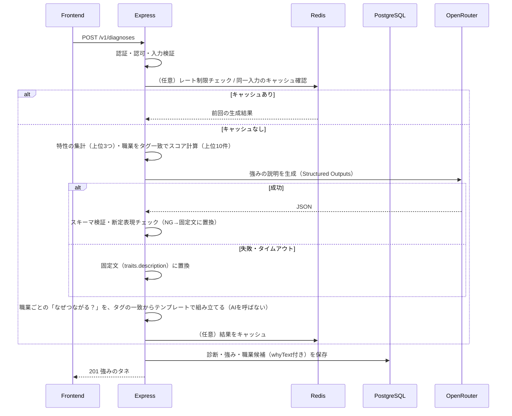

# API 設計

> 本書は概要・運用ルールと主要なリクエスト／レスポンス例を示す。**本書を API の仕様（正）とする**（`openapi.yaml` は作成しない）。
> **生徒の認証は案B（学校コード＋ニックネーム）の最小構成で暫定決定**（[`認証方式_検討メモ`](./認証方式_検討メモ.md)。チーム確認後に確定）。学校管理者は Firebase 認証。

## 1. 設計方針

- **スタイル**：REST（JSON）。フロント（Next.js）とバックエンド（Express）は別オリジン。CORS は `FRONTEND_URL` のみ許可。
- **バージョニング**：URL 埋め込み `/v1/...`
- **認証方式**：`Authorization: Bearer <token>` で送る。**トークンの種類はロールごとに異なる**。
  - **学校管理者**：**Firebase Authentication の ID トークン**。サーバーは Admin SDK で検証し、Firebase UID から **DB の `school_admins` を引いて**学校IDを決定する（custom claims は使わない）。DB に紐づかない UID は、すべて 403（**管理者の自己登録は廃止**。#11で決定。学校・管理者はseedで用意する）。
  - **生徒**：**認証なし（案B）**。`POST /v1/students/session` に学校コードとニックネームを送ると、サーバーが**セッショントークン（JWT・HS256・有効期限8時間）**を発行する。JWT の中身は生徒ID（`sub`）・学校ID・ロールのみ（個人情報は入れない）。署名鍵は環境変数 `SESSION_SECRET`。
  - **ルートごとに受け付けるトークンが決まっている**（生徒のルートは生徒のセッショントークンのみ、管理者のルートは Firebase ID トークンのみ）。
- **命名・形式**：パスは複数形の名詞、JSON は camelCase、日時は ISO 8601（UTC、例 `2026-10-04T00:00:00Z`）、ID は数値（一部 UUID は DB 設計で確定）。
- **認可**：ロール（`student` / `school_admin`）と**学校IDでのデータ絞り込み**を共通ミドルウェアで実施。他校のデータは取得・更新できない。
- **入力検証**：**express-validator を全ルートに適用**（body／params／query）。検証エラーは共通ミドルウェアで 400 に統一。
- **AI**：AI を呼ぶのは `POST /v1/diagnoses` の **1回だけ**（強みの説明のみを生成）。職業の選定は AI を使わずタグ一致で計算。**「なぜつながる？」もAIを使わない**（好きなもの・特性タグの一致から、テンプレートで組み立てる。#30で決定）。
- **キャッシュ**：Redis。**必須は職業・質問・好きなものマスタのキャッシュのみ**。診断結果のキャッシュとレート制限は、余裕があれば追加する（今回は必須としない）。

---

## 2. エンドポイント一覧

認証欄：**不要** = 認証なし／**要（未登録）** = ID トークンのみ（DB 未登録可）／**生徒**／**管理者** = ロール必須

### 共通

| メソッド | パス | 概要 | 認証 | 関連画面 |
| -------- | ---- | ---- | ---- | -------- |
| GET | /v1/health | 死活監視（ヘルスチェック） | 不要 | — |
| GET | /v1/me | ログイン中ユーザーの情報（ロール・学校ID） | 要（登録済み） | 全画面のログイン後判定 |

### 生徒

| メソッド | パス | 概要 | 認証 | 関連画面 |
| -------- | ---- | ---- | ---- | -------- |
| POST | /v1/students/session | 学校コードとニックネームで利用を開始し、セッショントークンを発行 | 不要 | UI-S01 |
| GET | /v1/masters/interests | 好きなものカード（12種）の一覧 | 生徒 | UI-S03 |
| GET | /v1/masters/questions | 自分らしさチェックの質問（5問）と選択肢 | 生徒 | UI-S04 |
| POST | /v1/diagnoses | 診断（カード＋回答）を送信。強みのタネ・職業候補を生成して保存 | 生徒 | UI-S04→S05 |
| GET | /v1/diagnoses/latest | 最新の診断結果（強みのタネ）を取得 | 生徒 | UI-S05 |
| GET | /v1/diagnoses/latest/jobs | 最新診断の職業候補（スワイプ用の一覧） | 生徒 | UI-S06 |
| GET | /v1/jobs/{jobId} | 職業詳細（なぜつながる？／仕事内容／関連学問） | 生徒 | UI-S07 |
| ~~PUT~~ | ~~/v1/jobs/{jobId}/discovered~~ | ~~「知らなかった！」を記録~~ **（今回は実装しない）** | 生徒 | UI-S06 |

### 学校管理者

| メソッド | パス | 概要 | 認証 | 関連画面 |
| -------- | ---- | ---- | ---- | -------- |
| ~~POST~~ | ~~/v1/schools/register~~ | ~~学校を作成し管理者として登録~~ **（今回は実装しない。#11で決定。学校・管理者はseedで用意する）** | — | — |
| GET | /v1/schools/me | 自校の情報（学校名・学校コード・契約状態・残日数） | 管理者 | UI-A03 |
| POST | /v1/billing/checkout-session | Stripe Checkout セッションを作成し遷移先URLを返す | 管理者 | UI-A03 |

### 外部（Stripe）

| メソッド | パス | 概要 | 認証 |
| -------- | ---- | ---- | ---- |
| POST | /v1/billing/webhook | Stripe Webhook（決済完了で契約状態を更新） | Stripe 署名検証（ID トークンは使わない） |

> 学校管理者のログイン／ログアウト／パスワード再設定は **Firebase Authentication をフロントから直接使う**ため、本 API には存在しない。生徒は「おわる」でフロントがトークンを破棄するだけで、専用の API はない。

### 認可マトリクス

| API | 未認証 | 未登録UID | 生徒 | 管理者 |
| --- | ------ | --------- | ---- | ------ |
| /v1/health | ○ | ○ | ○ | ○ |
| /v1/me | × | ×（403） | ○ | ○ |
| /v1/students/session | ○ | ○ | ○ | ○ |
| /v1/masters/*, /v1/diagnoses*, /v1/jobs/* | × | × | ○ | × |
| /v1/schools/me, /v1/billing/checkout-session | × | × | × | ○ |
| /v1/billing/webhook | 署名のみ | — | — | — |

（× は 401／403 を返す。詳細は §4）

---

## 3. リクエスト / レスポンス例

### 3.1 生徒の開始（案B）

生徒はアカウントを持たない。**学校コードとニックネームを送るだけ**で、セッショントークンを受け取る。

#### POST /v1/students/session

```http
POST /v1/students/session
Content-Type: application/json

{ "schoolCode": "UEDA123", "nickname": "みさき" }
```

検証：`schoolCode` 必須・英数字・1〜20文字（大文字小文字は区別しない）、`nickname` 必須・1〜20文字（前後の空白を除去）。

```json
// 201 Created
{
  "token": "<セッショントークン（JWT）>",
  "expiresIn": 28800,
  "student": { "id": 101, "nickname": "みさき" },
  "school": { "name": "上田みらい高等学校" }
}
```

- 呼び出しのたびに `students` に1行作成し、新しいトークンを発行する（**同じ生徒でも毎回新規**。ログインという概念はない）。
- フロントは `token` を `sessionStorage` に保存し、以降 `Authorization: Bearer <token>` で送る。**タブを閉じると消える**（結果の再表示はしない方針と整合）。
- エラー：`SCHOOL_CODE_NOT_FOUND`（404）、`VALIDATION_ERROR`（400）、`RATE_LIMITED`（429。余裕があれば実装）
- **学校コードの利用可否は、契約状態では制限しない**（契約切れの学校の生徒制限は今回実施しない。要件定義 FR-A05。将来の拡張：[`将来の拡張.md`](./将来の拡張.md)）。

### 3.2 学校管理者の登録

**管理者の自己登録は実装しない（#11で決定）。** 学校・学校管理者・契約は、すべてseedスクリプトで投入する（デモ用に、無料体験中／無料体験終了／契約中／契約期限切れの4パターンを用意する）。管理者は、事前にFirebaseコンソールで作成したアカウントで、UI-A02からログインする。

学校コードは英数字6文字程度・重複不可で自動発行（紛らわしい `0/O`・`1/I` は除外）。

### 3.3 共通

#### GET /v1/me

```json
// 200 OK（生徒）
{ "role": "student", "id": 101, "schoolId": 7, "nickname": "みさき" }

// 200 OK（管理者）
{ "role": "school_admin", "id": 5, "schoolId": 7 }
```

### 3.4 マスタ

#### GET /v1/masters/interests

```json
{
  "items": [
    { "id": 1, "code": "space", "label": "宇宙・星", "emoji": "🌙" },
    { "id": 2, "code": "it", "label": "PC・IT", "emoji": "💻" }
  ]
}
```
12件。並び順は `sortOrder`。Redis 1時間キャッシュ（`Cache-Control: max-age=3600`）。

#### GET /v1/masters/questions

```json
{
  "items": [
    {
      "id": 1,
      "text": "気になることを見つけたら？",
      "options": [
        { "id": 11, "label": "まず調べて詳しく知りたい", "emoji": "🔎" },
        { "id": 12, "label": "まず自分なりのアイデアを考えてみたい", "emoji": "✨" }
      ]
    }
  ]
}
```
5件・各2択。**選択肢が対応する特性（探究・発想…）はクライアントに返さない**（サーバー内で計算）。

### 3.5 診断

#### POST /v1/diagnoses

```http
POST /v1/diagnoses
Authorization: Bearer <token>
Content-Type: application/json

{
  "interestIds": [1, 4],
  "answers": [
    { "questionId": 1, "optionId": 11 },
    { "questionId": 2, "optionId": 21 },
    { "questionId": 3, "optionId": 32 },
    { "questionId": 4, "optionId": 41 },
    { "questionId": 5, "optionId": 51 }
  ]
}
```

検証：
- `interestIds`：整数の配列、**1〜3個**、重複なし、存在するIDのみ
- `answers`：**ちょうど5件**、各質問1回ずつ、`optionId` はその質問の選択肢であること

```json
// 201 Created
{
  "id": 3001,
  "createdAt": "2026-10-05T03:21:00Z",
  "strengths": [
    { "code": "explore", "title": "探究する力", "description": "気になったことを「もっと知りたい！」と、深く調べられるところがありそう。" },
    { "code": "ideate", "title": "発想する力", "description": "新しいアイデアや方法を考えることを楽しめるかも。" },
    { "code": "support", "title": "人を支える力", "description": "相手の話を聞きながら、周りを支えることができそう。" }
  ],
  "jobCount": 10
}
```

エラー：`VALIDATION_ERROR`（400）、`RATE_LIMITED`（429）。**AI の失敗・タイムアウト・不正な出力は、エラーにしない**（強みの説明を固定文に置き換えて、201 で返す。下記）

**処理の流れ**



- 生徒が再診断した場合は**最新の診断が有効**（**過去分は削除せず残す**。生徒は30日後に `students` ごと削除される。DB設計 §5）。
- **AI の失敗・タイムアウト・不正な出力（スキーマ違反・断定表現）のときは、エラーにせず、強みの説明を固定文（`traits.description`）に置き換えて診断を保存し、201 を返す**（案A・決定）。保存時は `used_fallback = true`、`ai_model = NULL`。フロントは AI の失敗を意識しない（再試行の画面は出さない）。
- （余裕があれば）同じ入力（好きなもの＋回答）は Redis のキャッシュから返し、AI を呼ばない（コスト・遅延対策）。必須ではない。

**特性の集計と職業のスコア（ルール）**

- 5問の回答から特性（探究・発想・人を支える・表現・こだわる）を数え、**多い順に上位3つ**を強みとする。**同数の場合は `traits.sort_order`（探究 → 発想 → 表現 → 人を支える → こだわる）の小さい順に選ぶ**（決定。実装を単純にし、結果を決定的にするため）。
  - 5問の得点は合計5点で同点が起きやすく、後ろの特性（人を支える・こだわる）は選ばれにくくなる。この偏りは承知のうえで採用する（見直す場合は入力由来の決定的な順序に変更する）。
  - **強みは順位をつけず、同列の「3つの強みのタネ」として扱う。** `strengths` は得点順ではなく `sort_order` 順に返し、画面もその順で表示する（並びが順位に見えないようにする）。`rank` は保存上の並びで、画面には出さない。
- 職業スコア ＝ 選んだ好きなものタグとの一致数 × 3 ＋ 強み上位3つとの一致数 × 2。上位10件を返す。好きなものが一致する職業が10件に満たない場合は、特性の一致が高い職業で補う。同点は職業ID の小さい順（**分野の分散は今回行わない**。結果が決定的でテストしやすい）。

#### GET /v1/diagnoses/latest

`POST` のレスポンスと同じ形。診断がなければ `404 DIAGNOSIS_NOT_FOUND`。

#### GET /v1/diagnoses/latest/jobs

診断がなければ `404 DIAGNOSIS_NOT_FOUND`（`GET /v1/diagnoses/latest` と同じ）。

```json
{
  "items": [
    {
      "id": 7,
      "name": "宇宙開発技術者",
      "summary": "ロケットや人工衛星を設計・開発する仕事です。",
      "interestTags": ["調べる・研究", "宇宙・星"],
      "imageUrl": null,
      "emoji": "🛰"
    }
  ]
}
```

順序＝おすすめ順（`rank`）。`imageUrl` は `/images/jobs/job-{id}.webp` 形式（画像がない職業は `null` で、`emoji` で代替）。**スコアは返さない**（順位を「向き不向き」と受け取らせないため）。
`interestTags` は好きなものの `sort_order` 順。

### 3.6 職業

#### GET /v1/jobs/{jobId}

- `jobId`：整数。存在しない場合は 404 `JOB_NOT_FOUND`。

```json
{
  "id": 7,
  "name": "宇宙開発技術者",
  "group": "研究・自然・工学・ものづくり",
  "interestTags": ["宇宙・星"],
  "imageUrl": null,
  "whyConnected": "あなたが選んだ「宇宙・星」への興味と、「探究する力」がこの仕事につながっているかもしれません。",
  "description": "ロケットや人工衛星の設計・開発・試験を行う仕事です。",
  "academics": [
    { "name": "工学（機械・電気）", "category": "science" },
    { "name": "情報学", "category": "science" },
    { "name": "地理学", "category": "mixed" }
  ]
}
```

- `interestTags` は好きなものの `sort_order` 順。
- `whyConnected`：**最新の診断に紐づく保存済み文章**（AI を使わず、タグの一致からテンプレートで組み立てる。`POST /v1/diagnoses` 時に、候補10件ぶんまとめて計算・保存する。#30で決定）。職業詳細の表示でも計算し直さない。最新の診断の候補に含まれない職業の場合も、同じルールでその場で計算する（保存はしない）。
  - **テンプレート**：診断で選んだ好きなものタグ（`interests.sort_order` の若い順）と、強み上位3つの特性タグ（`traits.sort_order` の若い順）のうち、その職業のタグと一致する最初の1つずつを使う。
    - 両方一致：「あなたが選んだ『{interest}』への興味と、『{trait}』がこの仕事につながっているかもしれません。」
    - 好きなものタグのみ一致：「あなたが選んだ『{interest}』への興味が、この仕事につながっているかもしれません。」
    - 特性タグのみ一致：「『{trait}』があなたの強みとして、この仕事につながっているかもしれません。」
    - どちらも一致なし（候補外の職業で、タグが重ならない場合）：「この仕事も、あなたにつながっているかもしれません。」
- `academics[].category`：`liberal_arts`（文系）／`science`（理系）／`mixed`（複合）。**文理は学問にだけ付け、職業には付けない**。
- 内部メモの「文理」列は返さない。

#### ~~PUT /v1/jobs/{jobId}/discovered~~（今回は実装しない）

~~ボディなし。冪等（何度呼んでも同じ結果）。`204 No Content`。~~

「知らなかった！」は今回実施しない（要件定義 FR-S07。将来の拡張：[`将来の拡張.md`](./将来の拡張.md)）。

### 3.7 学校管理者

#### GET /v1/schools/me

```json
// 無料体験中／無料体験終了
{
  "school": { "id": 7, "name": "上田みらい高等学校", "schoolCode": "UEDA123" },
  "contract": {
    "status": "trial",
    "trialEndsAt": "2026-10-19T00:00:00Z",
    "daysLeft": 18
  }
}

// 契約中／契約期限切れ
{
  "school": { "id": 7, "name": "上田みらい高等学校", "schoolCode": "UEDA123" },
  "contract": {
    "status": "active",
    "activeEndsAt": "2027-10-05T00:00:00Z"
  }
}
```

`contract.status`：`trial`（無料体験中）／`trial_expired`（無料体験終了）／`active`（契約中）／`contract_expired`（契約期限切れ）。`daysLeft` は `trial` のときのみ。`activeEndsAt` は `active`／`contract_expired` のときのみ。**状態の判定はサーバー側**（`trialEndsAt`／`activeEndsAt` と現在時刻から計算。DBには `trial`／`active` の2値のみ保存）で、フロントは表示するだけ。**契約期限切れでも、生徒側のAPI・画面は制限しない**（`FR-A05` は実施しない。この判定は管理画面の表示専用）。

#### POST /v1/billing/checkout-session

ボディなし（学校は認証から判定）。

```json
// 200 OK
{ "url": "https://checkout.stripe.com/c/pay/cs_test_..." }
```

- Checkout セッションは `mode: "payment"`（一括払い）、`line_items` は環境変数 `STRIPE_PRICE_ID` の価格（税込50,000円・一回払い）を1点。
- **`client_reference_id` に `schoolId` を設定する**（Webhookで学校を特定するため）。
- フロントは `url` へ遷移する。成功／キャンセル時の戻り先は `FRONTEND_URL/admin`（`?checkout=success|cancel`）。
- すでに `active` かつ期限内（`active_ends_at` を過ぎていない）の場合は 409 `ALREADY_SUBSCRIBED`。**契約期限切れ（`contract_expired`）の場合は、このAPIをそのまま呼べる**（UI-A03から再度Checkoutに遷移し、更新する。自動更新はしない）。

#### POST /v1/billing/webhook

- Stripe の署名（`Stripe-Signature`）を **生ボディで検証**（不正なら 400）。JSON パースより前に生ボディを保持する設定が必要。
- 処理するイベントは **`checkout.session.completed` のみ**。`payment_status` が `paid` であることを確認し、`client_reference_id`（`schoolId`）から学校を特定する。
- 契約を更新：`status='active'`、`activatedAt`＝現在時刻、`activeEndsAt`＝`activatedAt`＋1年、支払いID（`stripePaymentIntentId`）を保存（契約更新時は上書き）。
- **冪等**：処理済みの `event.id` を保存し、二重受信では何もしないで 200 を返す。
- 戻り：200（処理済み・無視するイベント含む）。

---

## 4. エラーレスポンス

### 共通フォーマット

```json
{
  "error": {
    "code": "VALIDATION_ERROR",
    "message": "入力内容を確認してください",
    "details": [
      { "field": "interestIds", "message": "1〜3個選んでください" }
    ]
  }
}
```

- `message` は**画面にそのまま出せる日本語**（原因が特定されすぎる文は避ける）。
- `details` は入力検証エラーのときのみ（`field` と `message`）。
- **内部エラーの詳細（スタックトレース、SQL、AI の生の応答）は返さない**（ログにのみ出す）。

### ステータスとエラーコード

| HTTP | code | 意味 | フロントの対応 |
| ---- | ---- | ---- | -------------- |
| 400 | VALIDATION_ERROR | 入力検証エラー | 入力欄の下に表示 |
| 401 | UNAUTHORIZED | トークンがない・不正・期限切れ | 生徒：入口（UI-S01）へ／管理者：ログイン画面へ |
| 403 | FORBIDDEN | ロール不足／未登録ユーザー | 権限エラー、または登録画面へ |
| ~~403~~ | ~~SCHOOL_NOT_AVAILABLE~~ | ~~契約切れの学校~~ **（今回は実装しない）** | ~~「このコードは現在ご利用いただけません」~~ |
| 404 | SCHOOL_CODE_NOT_FOUND | 学校コードが存在しない | 「学校コードが見つかりません」 |
| 404 | JOB_NOT_FOUND / DIAGNOSIS_NOT_FOUND | 対象なし | 共通エラー／診断へ誘導 |
| 409 | ALREADY_REGISTERED | すでに学校として登録済み（管理者のみ） | 管理画面へ誘導 |
| 409 | ALREADY_SUBSCRIBED | すでに契約中 | 表示更新 |
| 429 | RATE_LIMITED | 回数制限 | 「しばらくしてからもう一度」 |
| 500 | INTERNAL_ERROR | サーバーエラー | 共通エラー（もう一度試す） |

- ログイン失敗（メール・パスワード誤り）は Firebase が返すため、フロント側で「メールアドレスまたはパスワードを確認してください」に変換する（どちらが誤りかは出さない）。

---

## 5. レート制限・冪等性・キャッシュ

### レート制限（Redis）

> **今回は必須としない**（余裕があれば追加）。必須のキャッシュはマスタ系のみ。以下は追加する場合の案。

| 対象 | 制限（案） | キー |
| ---- | ---------- | ---- |
| `POST /v1/diagnoses` | **1ユーザーあたり 5回／10分** | ユーザーID |
| `POST /v1/students/session` | 学校コードが間違ったときだけカウント。10回／10分（総当たり対策） | IP |
| 上記以外の全 API | 120回／分 | ユーザーID（未認証はIP） |

- 超過時は 429 と `Retry-After` ヘッダーを返す。
- 学校のクラス全員が同時に診断する場面に耐えるため、**AI 呼び出しのタイムアウト15秒＋同時実行数の上限**をサーバー側に設ける（値は負荷確認で調整）。

### 冪等性

| API | 扱い |
| --- | ---- |
| `POST /v1/diagnoses` | 同じ入力はキャッシュで同じ結果を返す。二重送信しても診断の行が増えるだけ（過去分は残し、`created_at` が最新の1件を有効とする） |
| ~~`PUT /v1/jobs/{id}/discovered`~~ | ~~冪等（PUT）~~ **（今回は実装しない）** |
| `POST /v1/billing/webhook` | Stripe の `event.id` で二重処理防止 |
| `POST /v1/students/session` | 冪等ではない（呼ぶたびに新しいセッションを発行。古い `students` 行は定期削除。DB設計 §5） |

### キャッシュ

| 対象 | 保存先・TTL | 無効化 |
| ---- | ----------- | ------ |
| 好きなもの・質問マスタ | Redis 1時間＋`Cache-Control` | seed／マスタ更新時に削除 |
| 職業詳細（固定部分） | Redis 1時間 | 同上 |
| （任意）診断の生成結果（入力のハッシュ） | Redis 24時間 | 自然失効 |

> 必須なのはマスタ系（好きなもの・質問・職業詳細）のキャッシュのみ。「（任意）」の項目と図中の Redis 処理は、余裕があれば追加する。

**Redis が落ちてもサービスは止めない**（DB／AI にフォールバック。レート制限のみ無効化される点は許容）。

---

## 6. セキュリティ・運用ルール（API 共通）

- 全ルートに express-validator を適用し、**検証なしのルートを作らない**。
- 学校IDでの絞り込みを共通処理化（他校のデータを返さない）。
- **生徒のセッショントークン**：有効期限8時間、`sessionStorage` に保存、署名鍵 `SESSION_SECRET` はサーバー側のみ。トークンに個人情報を入れない。失効（強制ログアウト）はできない（期限切れを待つ）。学校コードは推測されにくい英数字6文字とし、総当たり対策としてIP単位のレート制限を（余裕があれば）付ける。
- レスポンスに**パスワード・トークン・Stripe のID・個人情報を含めない**（診断結果は本人のみ）。
- **AI へ送るデータ**は、強みの特性名と `traits.description` のみ（ニックネーム・学校名・職業マスタの文章は送らない）。自由記述は受け付けない。
- ログ：リクエストID・ユーザーID・所要時間・AI の成否を出力。本番は JSON、開発は整形。Authorization ヘッダーとボディのパスワードはマスクする。
- CORS：`FRONTEND_URL` のみ。Webhook はブラウザからの呼び出しではないので CORS 対象外。
- HTTPS 必須（本番）。`helmet` を有効化。

---

## 7. 未確定事項（API に影響するもの）

1. ~~生徒の認証方式~~ **案B（学校コード＋ニックネーム）で暫定決定**（チーム確認後に確定）。
2. ~~診断の履歴を残すか~~ **過去分は削除せず残し、最新を有効とする**（決定。診断の一覧 API は作らない）
3. ~~質問2の対応~~ ~~特性の同数時のタイブレーク~~ **解決済み**（5問の対応は DB設計 §6.3、同点は `traits.sort_order`）
4. 職業候補の件数（現在10件）と、最後まで見たあとの表示
5. ~~契約切れの学校の生徒の扱い（登録のみ不可か、既存生徒もログイン不可か）~~ 契約切れの生徒制限を実施しないため対象外
6. ~~職業画像（`imageUrl` の形式）~~ 決定：`/images/jobs/job-{id}.webp`（フロントの静的ファイルへのパス。API は文字列を返すだけで、画像の配信はフロントが行う。`images/` を挟むのは、職業一覧・詳細のページURL `/jobs`・`/jobs/[jobId]` と衝突しないようにするため）
7. レート制限（今回は必須としない。追加する場合の具体値は負荷の確認後に確定）
8. ~~`openapi.yaml` の作成担当~~ 作成しない（本書を仕様とする）

---

## 8. 画面と API の対応（確認用）

| 画面 | 呼び出す API |
| ---- | ------------ |
| UI-S01 入口 | `POST /v1/students/session` |
| UI-S02 | （欠番。生徒のログインはない） |
| UI-S03 好き・気になるカード | `GET /v1/masters/interests` |
| UI-S04 自分らしさチェック | `GET /v1/masters/questions`、（5問目で）`POST /v1/diagnoses` |
| UI-S05 強みのタネ | `POST /v1/diagnoses` の結果／`GET /v1/diagnoses/latest` |
| UI-S06 職業スワイプ | `GET /v1/diagnoses/latest/jobs`（~~`PUT /v1/jobs/{id}/discovered`~~ は今回実装しない） |
| UI-S07 職業詳細 | `GET /v1/jobs/{id}` |
| UI-A02 管理者ログイン | Firebase ログイン → `GET /v1/me` |
| UI-A03 管理画面 | `GET /v1/schools/me`、`POST /v1/billing/checkout-session` |
