# DB 設計

> 元資料：要件定義、API設計、データ準備 xlsx（`shigoto_mikke_data_prep .xlsx`）。
> 実装は **Prisma**（`backend/prisma/schema.prisma`）。本書のテーブル定義が正で、§7 に Prisma スキーマのたたき台を載せる。
> **生徒の認証は案B（学校コード＋ニックネーム）の最小構成で暫定決定**（チーム確認後に確定）。生徒はメール・パスワード・Firebase UID を持たない。

## 1. 設計方針

- **DBMS**：PostgreSQL（本番：Neon／開発：Docker Compose）
- **命名規則**：テーブルは snake_case の複数形、カラムは snake_case。Prisma のモデル名は PascalCase 単数形（`@@map` で対応付け）。主キーは `id`（`Int` の自動採番）、外部キーは `<テーブル単数>_id`。
- **時刻**：`timestamptz`（UTC）。作成日時 `created_at`、更新日時 `updated_at` を持つテーブルはその旨を記載。
- **削除方針**：**物理削除**（論理削除は使わない。実装を単純にするため）。学校を削除したら、配下の生徒・診断は `ON DELETE CASCADE` で削除する。マスタは削除せず `is_published` で非表示にする。
- **個人情報の最小化**：**生徒の個人情報は預からない**（保持は学校に紐づく**ニックネームのみ**。氏名・メール・生年月日は持たない）。個人情報は**学校管理者のメールアドレスのみ**（Firebase 側で管理。DB の `school_admins.email` は表示用）。パスワードは DB に保存しない。
- **マスタの管理**：マスタは xlsx から **seed で投入**（`code` をキーにした upsert）。DB を手で書き換えない。
- **ロール判定**：学校管理者は Firebase UID から `school_admins` を引く。**生徒はサーバー発行のセッショントークン（JWT）の `sub`（生徒ID）から `students` を引く**（API設計の認可方針）。
- **マイグレーション**：`prisma migrate dev`（開発）／`prisma migrate deploy`（本番）。マイグレーションファイルは Git 管理し、**マージ済みのファイルは書き換えない**（修正は新しいマイグレーションで行う）。

---

## 2. ER 図

テーブルが多いため、**3つの図に分けて**載せる（SVG。ブラウザ・VS Code・GitHub・Figma で表示できる）。

### 2.1 アカウント・契約



### 2.2 マスタ（職業・タグ・質問）



### 2.3 診断



- 図の元データは `docs/plan/diagrams/*.mmd`（Mermaid）。テーブルを変更したら `.mmd` を直して SVG を再生成する（[Mermaid Live Editor](https://mermaid.live) に貼って SVG を書き出す方法が簡単）。
- 図には主なカラムのみ載せている。全カラムは §3 を参照。
- draw.io 版が必要な場合は `docs/plan/diagrams/erd.drawio` を作成する。
- 分類：**アカウント・契約**（schools／school_admins／students／contracts／stripe_events）、**マスタ**（interests／traits／questions／question_options／job_groups／jobs／job_interests／job_traits／academic_fields／job_academic_fields）、**診断**（diagnoses／diagnosis_interests／diagnosis_answers／diagnosis_strengths／diagnosis_jobs）

---

## 3. テーブル定義

凡例：PK=主キー、FK=外部キー、UQ=ユニーク。`created_at`／`updated_at` は特記なければ全テーブル共通（`timestamptz`、NOT NULL、default now()。`updated_at` は更新時に自動更新）。

### 3.1 アカウント・契約

#### schools（学校）

| カラム名 | 型 | NULL | デフォルト | 説明 |
| -------- | -- | ---- | ---------- | ---- |
| id | int | NO | 自動採番 | PK |
| name | varchar(50) | NO | | 学校名 |
| school_code | varchar(20) | NO | | 生徒が入口で入力する学校コード。**UQ**（大文字で保存し、照合は大文字化して行う）。自動発行（英数字6文字、`0/O/1/I` を除く） |
| created_at / updated_at | timestamptz | NO | now() | |

#### school_admins（学校管理者）

| カラム名 | 型 | NULL | デフォルト | 説明 |
| -------- | -- | ---- | ---------- | ---- |
| id | int | NO | 自動採番 | PK |
| school_id | int | NO | | FK → schools.id（ON DELETE CASCADE） |
| firebase_uid | varchar(128) | NO | | Firebase の UID。**UQ** |
| email | varchar(255) | NO | | ログインメール（表示用。認証の正は Firebase） |
| created_at / updated_at | timestamptz | NO | now() | |

#### students（生徒）

| カラム名 | 型 | NULL | デフォルト | 説明 |
| -------- | -- | ---- | ---------- | ---- |
| id | int | NO | 自動採番 | PK。セッショントークンの `sub` |
| school_id | int | NO | | FK → schools.id（ON DELETE CASCADE） |
| nickname | varchar(20) | NO | | ニックネーム（**個人情報ではない扱い**。ほかの生徒・教員には表示しない） |
| created_at | timestamptz | NO | now() | セッション開始日時（下記の掃除の基準） |

> 案B：**生徒はアカウントを持たず、`POST /v1/students/session` のたびに1行作成する**（同じ人でも毎回新規）。そのため行が増え続ける。**作成から30日を過ぎた行は削除する**（診断は `ON DELETE CASCADE` で一緒に消える。実施方法は §5）。メール・Firebase UID の列は持たない。

#### contracts（契約）

| カラム名 | 型 | NULL | デフォルト | 説明 |
| -------- | -- | ---- | ---------- | ---- |
| id | int | NO | 自動採番 | PK |
| school_id | int | NO | | FK → schools.id（ON DELETE CASCADE）。**UQ**（学校ごとに1件） |
| status | enum contract_status | NO | 'trial' | `trial`（無料体験）／`active`（契約中）。**`expired`（無料体験終了）は保存せず、`status='trial'` かつ `trial_ends_at` を過ぎたらサーバーで判定する** |
| trial_ends_at | timestamptz | NO | | 無料体験終了日時 ＝ 学校登録日時 ＋ 30日 |
| stripe_customer_id | varchar(64) | YES | | Stripe の顧客ID |
| stripe_subscription_id | varchar(64) | YES | | Stripe のサブスクリプションID（または支払いID） |
| activated_at | timestamptz | YES | | 契約開始（Webhook 処理）日時 |
| created_at / updated_at | timestamptz | NO | now() | |

#### stripe_events（Stripe Webhook の処理済みイベント）

| カラム名 | 型 | NULL | デフォルト | 説明 |
| -------- | -- | ---- | ---------- | ---- |
| event_id | varchar(64) | NO | | PK。Stripe の `event.id`（二重処理防止） |
| type | varchar(64) | NO | | イベント種別（`checkout.session.completed`） |
| processed_at | timestamptz | NO | now() | 処理日時 |

### 3.2 マスタ（seed で投入。xlsx が元）

#### interests（好きなもの。12件）

| カラム名 | 型 | NULL | 説明 |
| -------- | -- | ---- | ---- |
| id | int | NO | PK |
| code | varchar(30) | NO | **UQ**。seed のキー（例：`space`） |
| label | varchar(30) | NO | 画面表示名（例：宇宙・星） |
| emoji | varchar(8) | NO | カード用の絵文字 |
| sort_order | smallint | NO | 表示順 |

#### traits（特性。5件）

| カラム名 | 型 | NULL | 説明 |
| -------- | -- | ---- | ---- |
| id | int | NO | PK |
| code | varchar(20) | NO | **UQ**：`explore`／`ideate`／`support`／`express`／`craft` |
| label | varchar(30) | NO | 探究する力／発想する力／人を支える力／表現する力／こだわる力（**正式名称**） |
| description | varchar(200) | NO | 特性の説明（AI へ渡す文脈・画面の補足に使用） |
| sort_order | smallint | NO | **同数時のタイブレーク順**を兼ねる（要確認） |

#### questions（自分らしさチェックの質問。5件）

| カラム名 | 型 | NULL | 説明 |
| -------- | -- | ---- | ---- |
| id | int | NO | PK（1〜5） |
| text | varchar(100) | NO | 質問文 |
| sort_order | smallint | NO | 表示順 |

#### question_options（質問の選択肢。10件）

| カラム名 | 型 | NULL | 説明 |
| -------- | -- | ---- | ---- |
| id | int | NO | PK。**固定ID：質問番号×10＋1／2**（11,12,21,22,…,51,52） |
| question_id | int | NO | FK → questions.id |
| label | varchar(100) | NO | 選択肢の文言 |
| emoji | varchar(8) | YES | アイコン |
| trait_id | int | NO | FK → traits.id。**この選択肢が示す特性**（API では返さない） |
| sort_order | smallint | NO | 表示順 |

#### job_groups（高校生向け8分野）

| カラム名 | 型 | NULL | 説明 |
| -------- | -- | ---- | ---- |
| id | int | NO | PK（1〜8） |
| name | varchar(50) | NO | 例：IT・データ・先端技術（xlsx の先頭番号は `sort_order` へ） |
| sort_order | smallint | NO | |

#### jobs（職業。現在39件）

| カラム名 | 型 | NULL | 説明 |
| -------- | -- | ---- | ---- |
| id | int | NO | PK（xlsx の ID と同じ値で投入） |
| job_group_id | int | NO | FK → job_groups.id |
| name | varchar(60) | NO | 職業名 |
| summary | varchar(120) | NO | スワイプ画面用の短い説明（2〜3行）。xlsx に列がないため、初期は「仕事内容」の先頭を使う |
| description | text | NO | 職業詳細の「どんな仕事？」（xlsx「仕事内容」） |
| image_url | varchar(255) | YES | 画像のパス（例：`/jobs/job-7.webp`）。AI生成画像をフロントの `public/jobs/` に置く。NULL の場合は `emoji` で代替 |
| emoji | varchar(8) | YES | 画像がない場合の代替 |
| is_published | boolean | NO | 既定 true。false は表示・推薦の対象外 |
| created_at / updated_at | timestamptz | NO | |

> xlsx の「文理」列（内部メモ）は **DB に持たない**（文理は学問領域側だけに持つ）。

#### job_interests（職業 × 好きなもの）

| カラム名 | 型 | 説明 |
| -------- | -- | ---- |
| job_id | int | FK → jobs.id（CASCADE） |
| interest_id | int | FK → interests.id |
| （PK） | | 複合主キー（job_id, interest_id） |

#### job_traits（職業 × 特性）

| カラム名 | 型 | 説明 |
| -------- | -- | ---- |
| job_id | int | FK → jobs.id（CASCADE） |
| trait_id | int | FK → traits.id |
| （PK） | | 複合主キー（job_id, trait_id） |

#### academic_fields（学問領域。現在22件）

| カラム名 | 型 | NULL | 説明 |
| -------- | -- | ---- | ---- |
| id | int | NO | PK |
| name | varchar(40) | NO | **UQ**。例：情報学 |
| category | enum academic_category | NO | `liberal_arts`（文系）／`science`（理系）／`mixed`（複合） |
| representative_topics | varchar(200) | YES | 代表的な学習項目（カンマ区切り。表示に使う場合は分割） |
| sort_order | smallint | NO | |

#### job_academic_fields（職業 × 学問領域）

| カラム名 | 型 | 説明 |
| -------- | -- | ---- |
| job_id | int | FK → jobs.id（CASCADE） |
| academic_field_id | int | FK → academic_fields.id |
| （PK） | | 複合主キー |

### 3.3 診断

#### diagnoses（診断）

| カラム名 | 型 | NULL | デフォルト | 説明 |
| -------- | -- | ---- | ---------- | ---- |
| id | int | NO | 自動採番 | PK |
| student_id | int | NO | | FK → students.id（ON DELETE CASCADE） |
| input_hash | char(64) | NO | | 入力（好きなものID・回答）の SHA-256。キャッシュキーと重複判定に使用 |
| ai_model | varchar(40) | YES | | 生成に使ったモデル名（フォールバック時は NULL） |
| used_fallback | boolean | NO | false | AI 出力が不正／不足で定型文に置換したか（監視用） |
| created_at | timestamptz | NO | now() | 診断日時 |

> **有効な診断＝生徒ごとに `created_at` が最新の1件**。**過去の診断は削除せず残す**（決定。診断の一覧・再表示は作らない。生徒は30日後に `students` ごと削除され、診断も連動して消える）。

#### diagnosis_interests（診断で選んだ好きなもの）

| カラム名 | 型 | 説明 |
| -------- | -- | ---- |
| diagnosis_id | int | FK → diagnoses.id（CASCADE） |
| interest_id | int | FK → interests.id |
| （PK） | | 複合主キー。アプリ側で1〜3件を保証 |

#### diagnosis_answers（診断の回答）

| カラム名 | 型 | 説明 |
| -------- | -- | ---- |
| diagnosis_id | int | FK → diagnoses.id（CASCADE） |
| question_id | int | FK → questions.id |
| option_id | int | FK → question_options.id。**その質問の選択肢であること**をアプリで検証 |
| （PK） | | 複合主キー（diagnosis_id, question_id）→ 1問1回答を保証 |

#### diagnosis_strengths（強みのタネ。診断につき3件）

| カラム名 | 型 | NULL | 説明 |
| -------- | -- | ---- | ---- |
| diagnosis_id | int | NO | FK → diagnoses.id（CASCADE） |
| rank | smallint | NO | 1〜3 |
| trait_id | int | NO | FK → traits.id |
| description | varchar(200) | NO | AI が生成した短い説明（「〜がありそう」） |
| （PK） | | | 複合主キー（diagnosis_id, rank） |

#### diagnosis_jobs（診断ごとの職業候補。診断につき最大10件）

| カラム名 | 型 | NULL | 説明 |
| -------- | -- | ---- | ---- |
| diagnosis_id | int | NO | FK → diagnoses.id（CASCADE） |
| rank | smallint | NO | おすすめ順（1〜10） |
| job_id | int | NO | FK → jobs.id |
| score | smallint | NO | マッチングのスコア（**監視・デバッグ用。API では返さない**） |
| why_text | varchar(300) | NO | 「なぜあなたにつながる？」（AI 生成。失敗時はタグから組み立てた定型文） |
| （PK） | | | 複合主キー（diagnosis_id, rank）／UQ（diagnosis_id, job_id） |

#### job_discoveries（「知らなかった！」。**今回は作らない**）

| カラム名 | 型 | 説明 |
| -------- | -- | ---- |
| student_id | int | FK → students.id（CASCADE） |
| job_id | int | FK → jobs.id |
| created_at | timestamptz | 押した日時 |
| （PK） | | 複合主キー（student_id, job_id）→ **PUT の冪等**を保証 |

---

## 4. インデックス・制約

| 対象 | 種別 | 目的 |
| ---- | ---- | ---- |
| schools.school_code | UQ | 学校コードの検索・重複防止 |
| school_admins.firebase_uid | UQ | 認証 UID からの引き当て（管理者のリクエスト毎） |
| contracts.school_id | UQ | 1学校1契約 |
| students.school_id／school_admins.school_id | INDEX | 学校単位の絞り込み |
| diagnoses (student_id, created_at DESC) | INDEX | 生徒の最新診断の取得 |
| diagnoses (input_hash) | INDEX | 同一入力の判定 |
| diagnosis_jobs (diagnosis_id, rank) | PK | 職業候補を順位順に取得 |
| job_interests (interest_id) ／ job_traits (trait_id) | INDEX | マッチング（タグから職業を引く） |
| interests.code／traits.code／academic_fields.name | UQ | seed の upsert キー |

**外部キー**：すべて `ON DELETE CASCADE`（親が消えたら子も消える）。ただし **マスタへの参照は削除不可（RESTRICT）**。
- 例：`diagnosis_jobs.job_id → jobs.id`、`diagnosis_answers.option_id → question_options.id`、`students.school_id → schools.id`（学校削除時は生徒も削除）。

**CHECK 制約・アプリ側の保証**
- `diagnosis_strengths.rank`／`diagnosis_jobs.rank` の範囲（1〜3／1〜10）
- `diagnoses` に紐づく `diagnosis_interests` は 1〜3件、`diagnosis_answers` は5件（DB では表現しにくいため**サービス層で検証**し、単体テストで担保）

---

## 5. データ保持・整合性ルール

| 対象 | ルール |
| ---- | ------ |
| 個人情報 | **生徒：預からない（ニックネームのみ）**。管理者：メールアドレスのみ。**AI に送るデータには含めない**（選択肢のラベル・特性の集計・職業マスタの文言のみ。ニックネームも送らない） |
| 診断結果 | 生徒に紐づけて保持。**過去分は削除せず残す**（最新を有効とする） |
| 学校・生徒の削除 | 学校の退会時は、配下の生徒・診断を**すべて削除**（CASCADE）。契約終了・退会後の保持期間は**要確認**（案：終了から90日で削除） |
| 生徒の削除 | 生徒本人／学校からの削除要請に対応できるよう、`students` 削除で関連する診断・「知らなかった！」も消える構造にする |
| stripe_events | Webhook の冪等用。**90日**で削除（バッチ）。 |
| Firebase 側 | 管理者のみ。DB の学校削除と別に、Firebase のユーザー削除が必要（退会処理で Admin SDK を呼ぶ。MVP では手動運用も可）。生徒は Firebase を使わない |
| students の掃除 | 作成から**30日**を過ぎた `students` 行を削除する（生徒が毎回新規行になるため）。実行は定期バッチ（例：起動時または1日1回）か、手動運用でもよい（データ量は小さい）。**将来、学校向けの集計を導入する場合は、この削除期間を見直す**（または集計値を別テーブルに残してから削除する。[`将来の拡張`](./将来の拡張.md)） |
| マスタの変更 | xlsx を更新 → seed を再実行（upsert）。職業の削除はせず `is_published=false`。**特性・好きなものの `code` は変更しない**（変更するとキャッシュ・診断履歴と不整合になる） |
| キャッシュ | マスタ更新時は Redis の該当キャッシュを削除 |
| バックアップ | Neon の自動バックアップ（ポイントインタイムリカバリ）に依存。本番デプロイ後に保持期間を確認 |
| 整合性の担保 | 複数テーブルへの保存（診断＋回答＋強み＋職業候補）は**1トランザクション**で行う（途中失敗時は全部ロールバック） |

---

## 6. マスタデータ投入（seed）ルール

xlsx → seed の対応と検証。seed は**冪等**（何度実行しても同じ結果）で、**不正な値があれば失敗させる**。

### 6.1 xlsx との対応

| xlsx シート・列 | DB |
| --------------- | -- |
| 好きなもの・特性タグ シートの12種 | interests（`code` は下表） |
| 特性タグ5種 | traits |
| 職業マスタ一覧「高校生向け8分野」 | job_groups（先頭の番号を `sort_order`） |
| 職業マスタ一覧「ID」「職業名」「仕事内容（下書き）」 | jobs.id／name／description（summary は description から生成） |
| 「好きなものタグ」（カンマ区切り） | job_interests |
| 「特性タグ」（カンマ区切り） | job_traits |
| 「学問領域タグ」（カンマ区切り） | job_academic_fields |
| 「文理」列 | **取り込まない**（内部メモ） |
| 学問領域タグ一覧 | academic_fields（`category`：文系→liberal_arts／理系→science／複合→mixed） |

### 6.2 コードの定義

| interests.code | label | | traits.code | label |
| -------------- | ----- | - | ----------- | ----- |
| talk | 人と話す | | explore | 探究する力 |
| game | ゲーム | | ideate | 発想する力 |
| health | 健康・からだ | | support | 人を支える力 |
| nature | 自然・環境 | | express | 表現する力 |
| research | 調べる・研究 | | craft | こだわる力 |
| art | 絵・デザイン | | | |
| making | ものづくり | | | |
| animal | 動物 | | | |
| food | 食べる・料理 | | | |
| space | 宇宙・星 | | | |
| sports | スポーツ | | | |
| it | PC・IT | | | |

### 6.3 質問と選択肢の特性（seed の固定値）

| question_options.id | 質問 | 選択肢 | 特性 |
| ------------------- | ---- | ------ | ---- |
| 11 / 12 | Q1 気になることを見つけたら？ | まず調べて詳しく知りたい ／ まずやってみたい | explore ／ ideate |
| 21 / 22 | Q2 グループで何かするときは？ | アイデアを出すことが多い ／ みんなの意見をまとめることが多い | express（**要確認**：ideate が自然） ／ support |
| 31 / 32 | Q3 何かを作るとき、楽しいのは？ | 新しいものや方法を考える ／ 細かいところまで仕上げる | ideate ／ craft |
| 41 / 42 | Q4 人と関わるなら？ | 自分から話したり伝えたりする ／ 相手の話を聞いたり支えたりする | express ／ support |
| 51 / 52 | Q5 課題や問題に出会ったら？ | 原因や仕組みを考える ／ 解決する方法を考える | explore ／ ideate |

### 6.4 seed の検証（不正なら失敗）

- 好きなものタグが上の12種以外
- 特性タグが5種以外（略称の「探究」「支える」などを含む）
- 学問領域タグが `academic_fields` に存在しない
- 好きなもの・特性・学問領域のいずれかが**空欄**の職業
- 職業 ID の重複

> 2026-09-19 時点の xlsx（39職業）は、上記の検証をすべて通過することを確認済み（旧ファイルの略称・欠落は修正済み）。

---

## 7. Prisma スキーマ（たたき台）

`backend/prisma/schema.prisma` の初期案。実装時に調整する。

```prisma
generator client { provider = "prisma-client-js" }
datasource db { provider = "postgresql"; url = env("DATABASE_URL") }

enum ContractStatus { trial active }
enum AcademicCategory { liberal_arts science mixed }

model School {
  id         Int      @id @default(autoincrement())
  name       String   @db.VarChar(50)
  schoolCode String   @unique @map("school_code") @db.VarChar(20)
  createdAt  DateTime @default(now()) @map("created_at") @db.Timestamptz
  updatedAt  DateTime @updatedAt @map("updated_at") @db.Timestamptz
  admins     SchoolAdmin[]
  students   Student[]
  contract   Contract?
  @@map("schools")
}

model SchoolAdmin {
  id          Int    @id @default(autoincrement())
  schoolId    Int    @map("school_id")
  firebaseUid String @unique @map("firebase_uid") @db.VarChar(128)
  email       String @db.VarChar(255)
  createdAt   DateTime @default(now()) @map("created_at") @db.Timestamptz
  updatedAt   DateTime @updatedAt @map("updated_at") @db.Timestamptz
  school      School @relation(fields: [schoolId], references: [id], onDelete: Cascade)
  @@index([schoolId])
  @@map("school_admins")
}

model Student {
  id          Int      @id @default(autoincrement())
  schoolId    Int      @map("school_id")
  nickname    String   @db.VarChar(20)
  createdAt   DateTime @default(now()) @map("created_at") @db.Timestamptz
  school      School   @relation(fields: [schoolId], references: [id], onDelete: Cascade)
  diagnoses   Diagnosis[]
  // discoveries JobDiscovery[]  // 「知らなかった！」は今回作らない
  @@index([schoolId])
  @@index([createdAt])
  @@map("students")
}

model Contract {
  id                   Int            @id @default(autoincrement())
  schoolId             Int            @unique @map("school_id")
  status               ContractStatus @default(trial)
  trialEndsAt          DateTime       @map("trial_ends_at") @db.Timestamptz
  stripeCustomerId     String?        @map("stripe_customer_id") @db.VarChar(64)
  stripeSubscriptionId String?        @map("stripe_subscription_id") @db.VarChar(64)
  activatedAt          DateTime?      @map("activated_at") @db.Timestamptz
  createdAt            DateTime       @default(now()) @map("created_at") @db.Timestamptz
  updatedAt            DateTime       @updatedAt @map("updated_at") @db.Timestamptz
  school               School         @relation(fields: [schoolId], references: [id], onDelete: Cascade)
  @@map("contracts")
}

model StripeEvent {
  eventId     String   @id @map("event_id") @db.VarChar(64)
  type        String   @db.VarChar(64)
  processedAt DateTime @default(now()) @map("processed_at") @db.Timestamptz
  @@map("stripe_events")
}

model Interest {
  id        Int    @id @default(autoincrement())
  code      String @unique @db.VarChar(30)
  label     String @db.VarChar(30)
  emoji     String @db.VarChar(8)
  sortOrder Int    @map("sort_order") @db.SmallInt
  jobs      JobInterest[]
  diagnoses DiagnosisInterest[]
  @@map("interests")
}

model Trait {
  id          Int    @id @default(autoincrement())
  code        String @unique @db.VarChar(20)
  label       String @db.VarChar(30)
  description String @db.VarChar(200)
  sortOrder   Int    @map("sort_order") @db.SmallInt
  jobs        JobTrait[]
  options     QuestionOption[]
  strengths   DiagnosisStrength[]
  @@map("traits")
}

model Question {
  id        Int    @id
  text      String @db.VarChar(100)
  sortOrder Int    @map("sort_order") @db.SmallInt
  options   QuestionOption[]
  answers   DiagnosisAnswer[]
  @@map("questions")
}

model QuestionOption {
  id         Int      @id
  questionId Int      @map("question_id")
  label      String   @db.VarChar(100)
  emoji      String?  @db.VarChar(8)
  traitId    Int      @map("trait_id")
  sortOrder  Int      @map("sort_order") @db.SmallInt
  question   Question @relation(fields: [questionId], references: [id])
  trait      Trait    @relation(fields: [traitId], references: [id])
  answers    DiagnosisAnswer[]
  @@map("question_options")
}

model JobGroup {
  id        Int    @id
  name      String @db.VarChar(50)
  sortOrder Int    @map("sort_order") @db.SmallInt
  jobs      Job[]
  @@map("job_groups")
}

model Job {
  id          Int      @id
  jobGroupId  Int      @map("job_group_id")
  name        String   @db.VarChar(60)
  summary     String   @db.VarChar(120)
  description String
  imageUrl    String?  @map("image_url") @db.VarChar(255)
  emoji       String?  @db.VarChar(8)
  isPublished Boolean  @default(true) @map("is_published")
  createdAt   DateTime @default(now()) @map("created_at") @db.Timestamptz
  updatedAt   DateTime @updatedAt @map("updated_at") @db.Timestamptz
  group       JobGroup @relation(fields: [jobGroupId], references: [id])
  interests   JobInterest[]
  traits      JobTrait[]
  academics   JobAcademicField[]
  recommended DiagnosisJob[]
  // discoveries JobDiscovery[]  // 「知らなかった！」は今回作らない
  @@map("jobs")
}

model JobInterest {
  jobId      Int @map("job_id")
  interestId Int @map("interest_id")
  job        Job      @relation(fields: [jobId], references: [id], onDelete: Cascade)
  interest   Interest @relation(fields: [interestId], references: [id])
  @@id([jobId, interestId])
  @@index([interestId])
  @@map("job_interests")
}

model JobTrait {
  jobId   Int @map("job_id")
  traitId Int @map("trait_id")
  job     Job   @relation(fields: [jobId], references: [id], onDelete: Cascade)
  trait   Trait @relation(fields: [traitId], references: [id])
  @@id([jobId, traitId])
  @@index([traitId])
  @@map("job_traits")
}

model AcademicField {
  id                   Int              @id @default(autoincrement())
  name                 String           @unique @db.VarChar(40)
  category             AcademicCategory
  representativeTopics String?          @map("representative_topics") @db.VarChar(200)
  sortOrder            Int              @map("sort_order") @db.SmallInt
  jobs                 JobAcademicField[]
  @@map("academic_fields")
}

model JobAcademicField {
  jobId           Int @map("job_id")
  academicFieldId Int @map("academic_field_id")
  job             Job           @relation(fields: [jobId], references: [id], onDelete: Cascade)
  academicField   AcademicField @relation(fields: [academicFieldId], references: [id])
  @@id([jobId, academicFieldId])
  @@map("job_academic_fields")
}

model Diagnosis {
  id           Int      @id @default(autoincrement())
  studentId    Int      @map("student_id")
  inputHash    String   @map("input_hash") @db.Char(64)
  aiModel      String?  @map("ai_model") @db.VarChar(40)
  usedFallback Boolean  @default(false) @map("used_fallback")
  createdAt    DateTime @default(now()) @map("created_at") @db.Timestamptz
  student      Student  @relation(fields: [studentId], references: [id], onDelete: Cascade)
  interests    DiagnosisInterest[]
  answers      DiagnosisAnswer[]
  strengths    DiagnosisStrength[]
  jobs         DiagnosisJob[]
  @@index([studentId, createdAt(sort: Desc)])
  @@index([inputHash])
  @@map("diagnoses")
}

model DiagnosisInterest {
  diagnosisId Int @map("diagnosis_id")
  interestId  Int @map("interest_id")
  diagnosis   Diagnosis @relation(fields: [diagnosisId], references: [id], onDelete: Cascade)
  interest    Interest  @relation(fields: [interestId], references: [id])
  @@id([diagnosisId, interestId])
  @@map("diagnosis_interests")
}

model DiagnosisAnswer {
  diagnosisId Int @map("diagnosis_id")
  questionId  Int @map("question_id")
  optionId    Int @map("option_id")
  diagnosis   Diagnosis      @relation(fields: [diagnosisId], references: [id], onDelete: Cascade)
  question    Question       @relation(fields: [questionId], references: [id])
  option      QuestionOption @relation(fields: [optionId], references: [id])
  @@id([diagnosisId, questionId])
  @@map("diagnosis_answers")
}

model DiagnosisStrength {
  diagnosisId Int    @map("diagnosis_id")
  rank        Int    @db.SmallInt
  traitId     Int    @map("trait_id")
  description String @db.VarChar(200)
  diagnosis   Diagnosis @relation(fields: [diagnosisId], references: [id], onDelete: Cascade)
  trait       Trait     @relation(fields: [traitId], references: [id])
  @@id([diagnosisId, rank])
  @@map("diagnosis_strengths")
}

model DiagnosisJob {
  diagnosisId Int    @map("diagnosis_id")
  rank        Int    @db.SmallInt
  jobId       Int    @map("job_id")
  score       Int    @db.SmallInt
  whyText     String @map("why_text") @db.VarChar(300)
  diagnosis   Diagnosis @relation(fields: [diagnosisId], references: [id], onDelete: Cascade)
  job         Job       @relation(fields: [jobId], references: [id])
  @@id([diagnosisId, rank])
  @@unique([diagnosisId, jobId])
  @@map("diagnosis_jobs")
}

// ※「知らなかった！」は今回実施しないため、以下のモデルは**作らない**（将来の拡張。docs/将来の拡張.md）
// model JobDiscovery {
//   studentId Int      @map("student_id")
//   jobId     Int      @map("job_id")
//   createdAt DateTime @default(now()) @map("created_at") @db.Timestamptz
//   student   Student  @relation(fields: [studentId], references: [id], onDelete: Cascade)
//   job       Job      @relation(fields: [jobId], references: [id])
//   @@id([studentId, jobId])
//   @@map("job_discoveries")
// }
```

> `students` は生徒が開始するたびに1行増える（古い行は定期的に削除する。§5）。

---

## 8. Redis のキー設計（参考）

> **必須は「マスタ系（`master:*`／`job:{id}`）」のみ**。診断結果のキャッシュとレート制限は余裕があれば追加（今回は必須としない）。

DB ではないが、データの持ち方をそろえるため記載。TTL 切れ・Redis 停止でも動くこと（DB／AI にフォールバック）。

| 用途 | キー | 値 | TTL |
| ---- | ---- | -- | --- |
| マスタ（好きなもの） | `master:interests` | JSON | 1時間 |
| マスタ（質問） | `master:questions` | JSON | 1時間 |
| 職業詳細（固定部分） | `job:{id}` | JSON | 1時間 |
| 診断の生成結果 | `diag:{input_hash}` | JSON（強み＋職業ごとの文章） | 24時間 |
| 診断のレート制限 | `rl:diag:{student_id}` | カウンタ | 10分 |
| 登録のレート制限 | `rl:register:{ip}` | カウンタ | 10分 |
| 全体のレート制限 | `rl:api:{user_id または ip}` | カウンタ | 1分 |

> **診断結果のキャッシュは職業ごとの「なぜつながる？」文を含む**。同じ入力なら別の生徒にも同じ文章を返してよい（個人情報を含まないため）。

---

## 9. 未確定事項（DB に影響するもの）

1. ~~生徒の認証方式~~ **案B（学校コード＋ニックネーム）で暫定決定**（`students` は school_id と nickname のみ）
2. ~~診断の履歴を残すか~~ **過去分は削除せず残す**（決定）
3. 契約終了・退会後のデータ保持期間（案：90日）
4. 質問2の選択肢A の特性（express か ideate）と、同数時のタイブレーク順
5. ~~職業画像の持ち方~~ **AI生成画像を `public/jobs/` に静的配置し、`image_url` にパスを保持**（決定）
6. 職業の summary の元データ（xlsx に列を追加するか、description から生成するか）
7. 案内・お知らせ等の追加テーブルの要否（現時点では不要）
