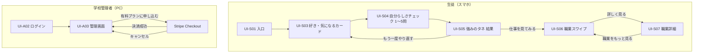
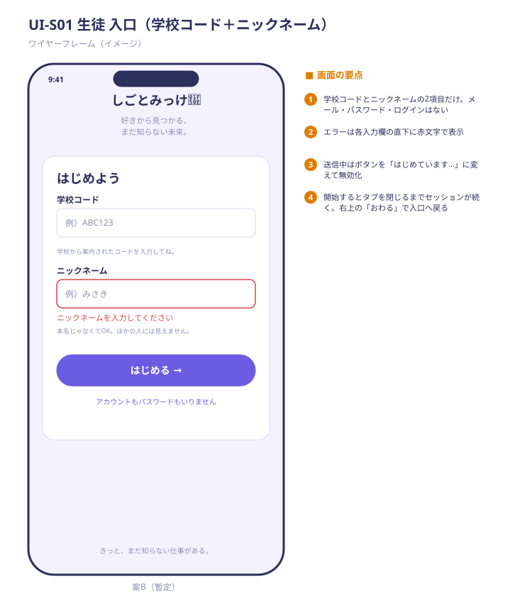
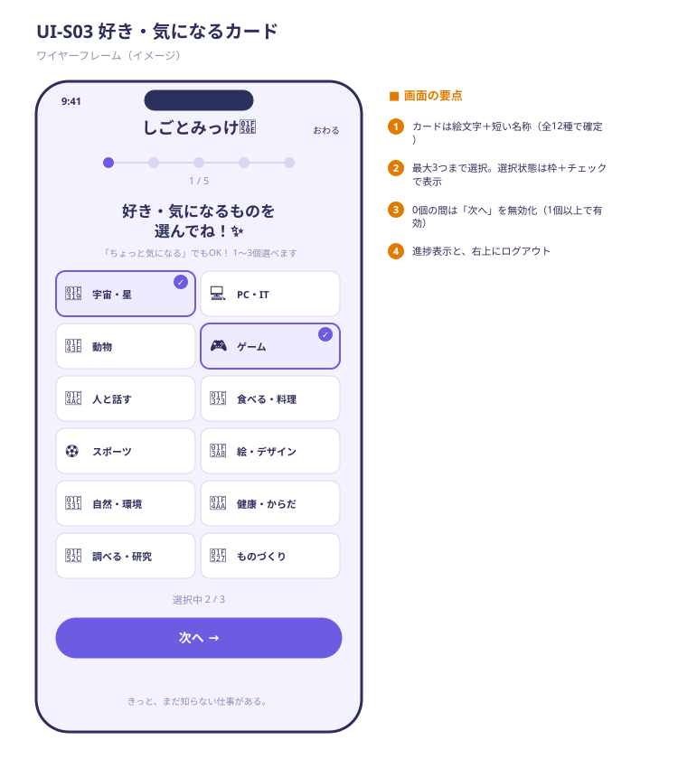
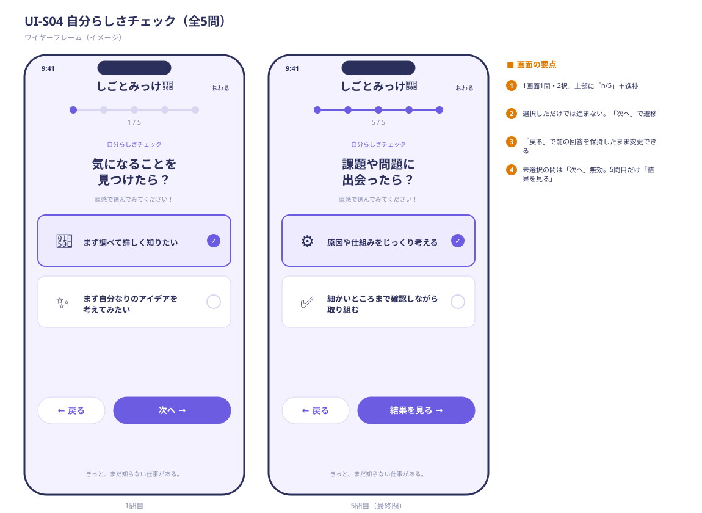
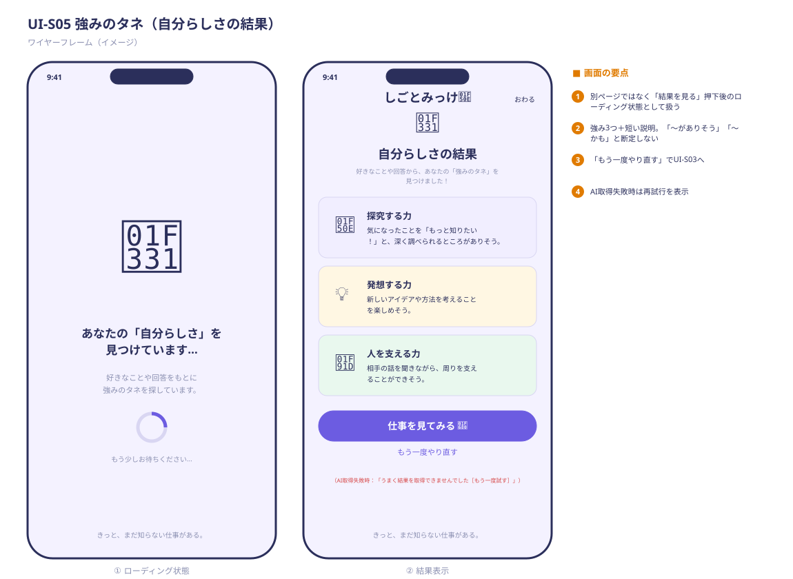
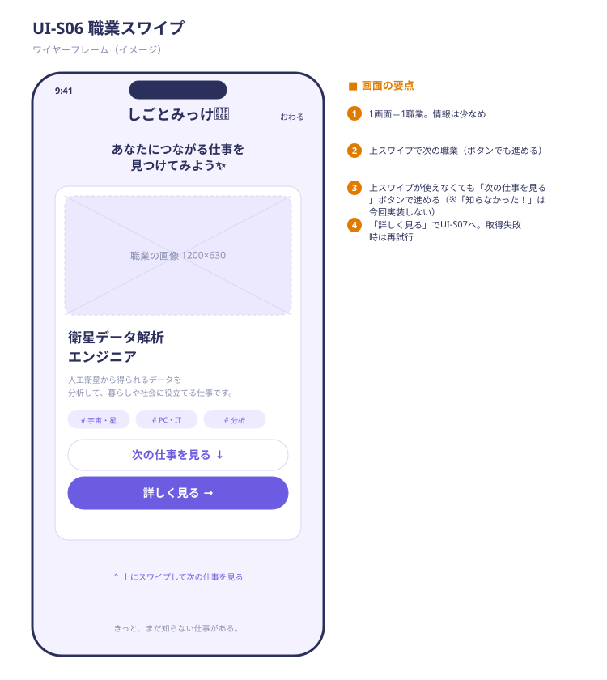
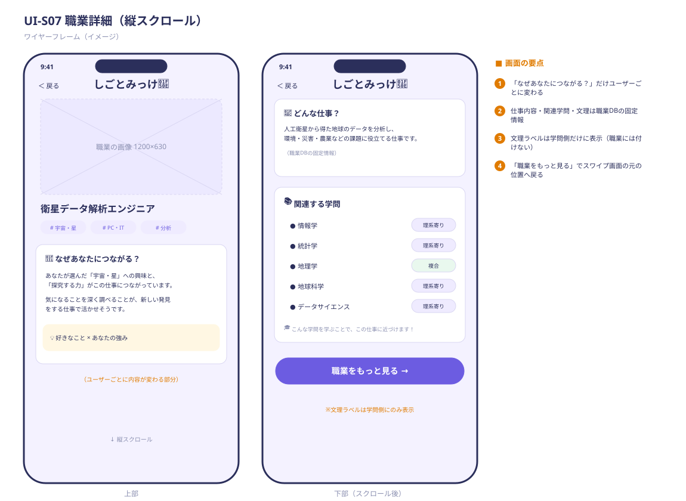
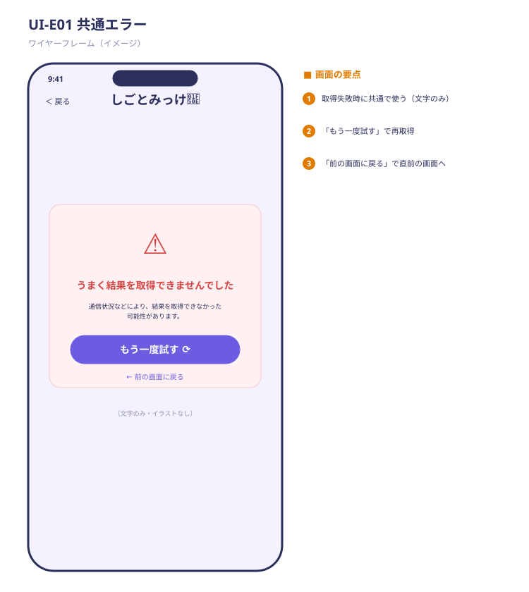
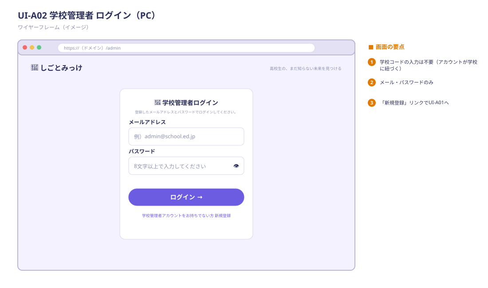
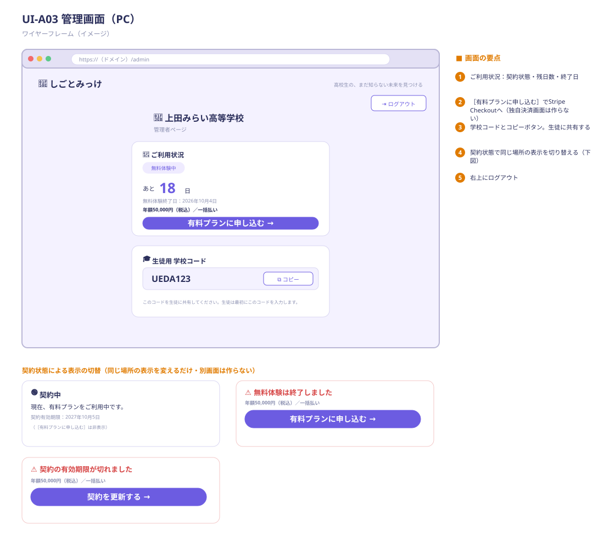

# 画面設計

> 元資料：「しごとみっけ画面構成（案）生徒使用画面MVP案」PDF。
> **生徒の認証は案B（学校コード＋ニックネーム）の最小構成で暫定決定**（[`認証方式_検討メモ`](./認証方式_検討メモ.md)。チーム確認後に確定）。生徒画面にメール・パスワード・ログイン画面はない（UI-S02 は欠番）。
> API 名は仮。[`API設計`](./API設計.md) 作成時に確定する。

## 1. 設計方針

- **ターゲットデバイス**
  - 生徒画面：**スマホファースト**（幅360px〜。iOS Safari／Android Chrome）。縦画面のみを想定
  - 学校管理者画面：**PCファースト**（Chrome／Edge／Safari 最新2バージョン）。スマホでも崩れない程度のレスポンシブ
- **デザインシステム・UI ライブラリ**
  - Next.js＋Tailwind CSS。コンポーネントは自作の共通部品を中心にし、重いUIライブラリは入れない
  - トーン：やわらかい紫系（メイン `#6C5CE1` 付近）、白カード、角丸大きめ、余白広め。キャラクター表現は絵文字（🔎🌱💡🚀）。キャッチコピー「好きから見つかる、まだ知らない未来。」等はチームで別途検討（PDFの方針）
  - 各画面の下部に「きっと、まだ知らない仕事がある。」の装飾テキスト（任意）
- **アクセシビリティ方針**
  - 選択状態は**色だけに頼らずチェックマーク・枠線**で示す（カード、2択）
  - タップ領域は最小44×44px、本文は16px以上、コントラスト比は WCAG AA（4.5:1）を目安
  - ローディング・エラーは文字でも伝える（アイコンのみにしない）
  - 高校生に伝わる平易な表現。断定を避け「〜かも」「〜がありそう」を使う（企画理念）
  - `prefers-reduced-motion` ではスワイプ・トースト等のアニメーションを抑える
- **共通ルール**
  - 生徒画面のヘッダー：ロゴ＋右上に「おわる」（セッションを終了して入口へ戻る）
  - 「次へ」「戻る」ボタンは画面下部に固定
  - 通信失敗は各画面で「もう一度試す」を出す（共通エラー表示を使う）

## 1.5 生徒画面の「完成の定義」（最優先事項）

生徒画面の7画面（UI-S01／S03／S04／S05／S06／S07／E01）は、次をすべて満たして「完成」とする。**すべての画面で確認するチェックリスト**として使う。

| 観点 | 完成の基準 |
| ---- | ---------- |
| 動作 | 全画面がスマホ実機（iOS Safari／Android Chrome、幅360px〜）で崩れずに通して動く |
| 状態 | **ローディング／エラー／空／未入力**の表示がすべての画面にある（画面設計の各画面の記載どおり） |
| 文言 | 断定しない（「〜かも」「〜がありそう」）。「向いている」「〜すべき」を使わない。高校生に伝わる平易な表現 |
| 見た目 | デザイントークン（色・角丸・余白・フォント）を全画面で統一。共通コンポーネントを使う |
| 操作 | 選択状態が枠＋チェックで分かる。ボタンの有効／無効が明確。タップ領域は44px以上。スワイプはボタンでも代替できる |
| 速度 | 画面遷移は体感で待たされない。AI待ちは「見つけています…」の表示で不安にさせない（10秒以内を目標） |
| 失敗時 | AI が失敗しても画面が壊れない：強みのタネ生成の失敗は、固定文（`traits.description`）で表示する（エラーにしない。案A）。`whyConnected`（なぜつながる？）はAIを使わないテンプレートのため、失敗しない（#30で決定） |
| 内容 | 職業の説明・「なぜつながる？」の文が、画面上で読みやすい長さ・誤字なし。画像は全職業に用意（絵文字での代替も可） |
| アクセシビリティ | コントラスト比 AA、色だけに依存しない、文字は16px以上（本文） |

> 実施しない機能（「知らなかった！」ボタン、結果の再表示、結果共有）は、画面に**表示しない**（ワイヤーフレームの「知らなかった！」ボタンは実装しない）。

## 1.6 職業画像の仕様（AI生成）

職業画像は**AIで制作中**（担当者が制作）。制作物がそのまま画面に使えるよう、次の仕様で統一する。

| 項目 | 仕様 |
| ---- | ---- |
| 枚数 | 1職業につき1枚（全職業。画像がない職業は絵文字で代替できるようにしておく） |
| 縦横比・サイズ | **1200×630px（約1.9:1の横長）**。スワイプ画面のカードと職業詳細のヘッダーの両方で、**比率どおり**（CSS：`aspect-ratio: 1200 / 630`、`object-fit: cover`）に表示する。端末の幅によってはわずかに左右が切れるため、**主役は中央の8割以内**に収める |
| 形式・容量 | **WebP、1枚200KB以下**（スマホでの表示速度のため。地方の回線を想定） |
| ファイル名・置き場所 | `job-{職業ID}.webp`（例：`job-7.webp`）。フロントの `public/images/jobs/` に置く。DB の `jobs.image_url` には `/images/jobs/job-7.webp` を保存する |
| スタイル | **全画像で統一**（同じスタイルのプロンプトの型を使う）。やわらかい紫系のパステル、丸みのあるイラスト、余白多めを想定 |
| 禁止事項 | 画像内に**文字を入れない**（誤字になりやすく、多言語・表示崩れの元）。**実在の人物・企業ロゴ・キャラクターを描かない**（権利・肖像の問題） |
| 内容の確認 | 職業を**誤解させない絵**か、A・B・E で全件を目視確認する（例：職業と関係ない道具、性別・人種の偏り、不自然な手など） |
| 代替テキスト | `alt` には職業名を入れる（画像だけに情報を頼らない） |
| 権利 | 使用するAI画像生成サービスの**利用規約**（商用利用・権利の帰属）を確認する。学校へ提供する製品のため、クレジット表記の要否も確認 |

### 画像の受け渡し

| 段階 | 場所 | 内容 |
| ---- | ---- | ---- |
| ① 制作物の置き場 | Google Drive「画像格納　チームC」（<https://drive.google.com/drive/folders/1lrfcmxMh35NktKRDvaKFyCKeDcS11tDf>） | 制作担当が、仕様どおりのファイル名（`job-{職業ID}.webp`）でアップロードする |
| ② アプリへの取り込み | リポジトリの `frontend/public/images/jobs/` | Drive から**コピーして Git にコミット**する（担当：A または B。PR で確認） |
| ③ 表示 | 本番のフロント（Vercel）から `/images/jobs/job-{ID}.webp` で配信（ページURL `/jobs`・`/jobs/[jobId]` と衝突しないよう `images/` を挟む） | **Drive の URL は画面から直接参照しない**（共有設定や転送量の上限で表示が壊れるため） |

- Drive は**制作・共有用**。アプリが読むのは②のリポジトリ内のファイルだけ。
- スプレッドシートの職業マスタの「画像素材」列に、制作状況（未着手／制作中／取り込み済み）を入れて進み具合を見えるようにする。
- Drive の共有設定は「チームメンバーのみ」にする（「リンクを知っている全員が編集可」にしない）。**このリンクをリポジトリを公開する場合は載せない**（公開する場合は本行を削除する）。

> 期限：**Week2 の終わり（10/4）までに、全職業の画像を `public/images/jobs/` に置く**。間に合わない職業は絵文字で代替して先へ進む（画面設計上は絵文字でも崩れない）。

## 2. 画面遷移図

- Figma／draw.io での画面デザイン：（リンクを貼る）
- 共通エラー（UI-E01）は全画面から遷移し、「もう一度試す」で元画面に戻る（図では省略）。

## 3. 画面一覧

### 生徒画面

| 画面 ID | 画面名 | 役割 | 主な入出力 | 関連 API（仮） |
| ------- | ------ | ---- | ---------- | -------------- |
| UI-S01 | 入口 | 学校コードとニックネームで利用を開始 | 入力：学校コード・ニックネーム | POST /v1/students/session |
| UI-S02 | （欠番） | 案Bで廃止（ログイン画面は作らない） | — | — |
| UI-S03 | 好き・気になるカード | 好き・気になるものを1〜3個選ぶ | 入出力：カード（12種）の選択 | GET /v1/masters/interests |
| UI-S04 | 自分らしさチェック | 5問の2択で特性を把握 | 入出力：Q1〜Q5の回答 | GET /v1/masters/questions、POST /v1/diagnoses |
| UI-S05 | 強みのタネ（結果） | 回答から決まった強み3つを表示（各強みの説明はAI生成） | 出力：強み3つ＋短い説明。操作：「仕事を見てみる」「もう一度やり直す」 | POST /v1/diagnoses（AI生成）、GET /v1/diagnoses/latest |
| UI-S06 | 職業スワイプ | 1画面1職業で上スワイプ閲覧 | 出力：職業名・短い説明・興味タグ。操作：詳しく見る、次の仕事を見る | GET /v1/diagnoses/latest/jobs（~~PUT /v1/jobs/{id}/discovered~~ は今回実装しない） |
| UI-S07 | 職業詳細 | 職業の理解と学問・文理とのつながり | 出力：なぜあなたにつながる？／どんな仕事？／関連する学問（文理ラベル） | GET /v1/jobs/{id} |
| UI-E01 | 共通エラー | 取得失敗時の再試行 | 操作：もう一度試す／前の画面に戻る | — |

### 学校管理者画面

| 画面 ID | 画面名 | 役割 | 主な入出力 | 関連 API（仮） |
| ------- | ------ | ---- | ---------- | -------------- |
| UI-A02 | 管理者 ログイン | 管理者ログイン（学校コード入力なし） | 入力：メール・パスワード | Firebase ログイン → GET /v1/me |
| UI-A03 | 管理画面 | 契約状況の確認・学校コードの取得・有料申込 | 出力：契約状態／残日数／終了日／学校コード。操作：コピー、有料プランに申し込む、ログアウト | GET /v1/schools/me、POST /v1/billing/checkout-session |

### ルーティング（URL）

生徒画面（フロントのトップレベル）：

| 画面 | パス | 補足 |
| --- | --- | --- |
| UI-S01 入口 | `/` | |
| UI-S03 好き・気になるカード | `/interests` | |
| UI-S04 自分らしさチェック | `/questions` | |
| UI-S05 強みのタネ | `/strengths` | |
| UI-S06 職業スワイプ | `/jobs` | |
| UI-S07 職業詳細 | `/jobs/[jobId]` | 職業IDをパスに含める |

管理者画面：

| 画面 | パス |
| --- | --- |
| UI-A02 管理者ログイン | `/admin/login` |
| UI-A03 管理画面 | `/admin` |

- UI-E01（共通エラー）に専用のURLはない（各画面の中に表示する部品）。
- 選択したカード・回答は、URLに含めない。クライアント側の状態（React state／sessionStorage）で保持する（ページの再読み込みで消えるのは許容）。
- 生徒：`/interests` 以降のページに、有効なトークンなしでアクセスした場合は `/` へリダイレクトする。
- 管理者：`/admin` に、未ログインでアクセスした場合は `/admin/login` へリダイレクトする。

## 4. 各画面の詳細

### UI-S01 入口（生徒）

- **レイアウト**：ロゴ、キャッチコピー、カード「はじめよう」内に入力欄2つ、［はじめる →］。**パスワード・メール・ログインリンクはない**
- **入力項目**：
  - 学校コード：例）ABC123。補足「学校から案内されたコードを入力してね。」
  - ニックネーム：例）みさき。補足「本名じゃなくてOK。ほかの人には見えません。」
- **状態**：
  - 送信中：ボタンを「はじめています…」表示＋無効化
  - エラー：各入力欄の**すぐ下**に赤文字で表示
- **遷移**：成功→UI-S03
- **セッション**：開始するとサーバーがセッショントークンを発行し、`sessionStorage` に保存する（**タブを閉じると終了**）。有効な間は入口を飛ばして UI-S03 以降に進める。切れたら入口へ戻る。
- **ヘッダーの「おわる」**：セッションを破棄して UI-S01 へ戻る

### UI-S02（欠番）

案B では生徒のログイン画面を作らない（生徒はアカウントを持たない）。

### UI-S03 好き・気になるカード

- **見出し**：「好き・気になるものを選んでね✨」、補足「『ちょっと気になる』でもOK！ 1〜3個選べます」
- **進捗**：ステップ表示＋「選択中 n/3」。**進捗の数値は未確定**（元PDFは「3/5」、ワイヤーフレームは「1/5」）
- **カード**：絵文字＋短い名称（全12種：🌙宇宙・星／💻PC・IT／🐾動物／🎮ゲーム／💬人と話す／🍳食べる・料理／⚽スポーツ／🎨絵・デザイン／🌱自然・環境／💪健康・からだ／🔬調べる・研究／🔧ものづくり）。2列グリッド
  - **12種で確定**（チーム決定：人と話す／ゲーム／健康・からだ／自然・環境／調べる・研究／絵・デザイン／ものづくり／動物／食べる・料理／宇宙・星／スポーツ／PC・IT）。職業マスタの「好きなものタグ」は必ずこの12種と一致させる。旧案の 音楽・旅行・おでかけ・科学・実験 は廃止
- **選択ルール**：最大3つ。3つ選択済みの状態で4つ目をタップした場合は無反応＋「3つまで選べます」を表示
- **ボタン**：「次へ →」。**選択0個の間は無効**（1個以上で有効）
- **ヘッダー**：ロゴ、右上「おわる」
- **遷移**：次へ→UI-S04

### UI-S04 自分らしさチェック

- **構成**：全5問、1画面1問、2択。上部に「n/5」＋進捗ドット
- **表示**：ラベル「自分らしさチェック」、質問文、補足「直感で選んでみてください！」、選択肢2つ（カード形式・アイコン付き）、［← 戻る］［次へ →］
- **質問と選択肢**：
  | # | 質問 | 選択肢A | 選択肢B |
  | - | ---- | ------- | ------- |
  | 1 | 気になることを見つけたら？ | まず調べて詳しく知りたい | まず自分なりのアイデアを考えてみたい |
  | 2 | みんなで何かをするとき、自然とやっているのは？ | 自分の考えをみんなに伝えることが多い | 困っている人に声をかけたり手伝ったりする |
  | 3 | 何かを作るとき、楽しいのは？ | 新しいものや方法を考える | 細かいところまで丁寧に仕上げる |
  | 4 | 友だちから相談されたら？ | 自分の考えをわかりやすく伝える | まず相手の話をじっくり聞く |
  | 5 | 課題や問題に出会ったら？ | 原因や仕組みをじっくり考える | 細かいところまで確認しながら取り組む |
- **操作**：
  - 選択しただけでは進まない（選択状態を枠＋チェックで表示）。「次へ」で遷移
  - 「戻る」で前の質問へ。**前の回答は保持して変更可能**。1問目の「戻る」はUI-S03へ
  - 未選択の間は「次へ」無効
  - 5問目のボタンは「**結果を見る →**」
  - ローディングは基本なし（結果画面側で表示）
- **回答→特性の対応**はスプレッドシート「好きなもの・特性タグ」シート参照（探究／発想／表現／人を支える／こだわる）

### UI-S05 強みのタネ（結果）

- **ローディング状態**（別ページではなく「結果を見る」押下後の状態）：🌱＋「あなたの『自分らしさ』を見つけています…」＋くるくる＋「もう少しお待ちください…」
- **結果状態**：見出し「自分らしさの結果」、サブ「好きなことや回答から、あなたの『強みのタネ』を見つけました！」
  - 強みカード3つ：アイコン＋名称（例：探究する力／発想する力／人を支える力）＋短い説明。「〜がありそう」「〜かも」のニュアンス。**順位はつけず、同列の「3つの強みのタネ」として表示する**（並びは特性の固定順＝`sort_order`。得点順にしない）
  - ボタン：［仕事を見てみる 🚀］（→UI-S06）、リンク［もう一度やり直す］（→UI-S03。選択済みの内容を初期表示するか要確認）
- **エラー**：AI の失敗では、エラー表示を出さない（固定文で結果を表示する。案A）。通信エラーや、待機が長引いた場合（案：20秒超）は、共通エラー（UI-E01）を表示する
- **補足**：強みは特性タグ5種のうち上位3つ。AI生成文は必ずサーバーで検証し、断定表現が含まれる場合・AI が失敗した場合は、固定文（`traits.description`）にフォールバック

### UI-S06 職業スワイプ

- **見出し**：「あなたにつながる仕事を見つけてみよう✨」
- **カード**（1画面＝1職業・情報は少なめ）：イラスト／画像、職業名、短い説明（2〜3行）、興味タグ（#宇宙・星 #PC・IT #調べる・研究）、［次の仕事を見る ↓］（スワイプの代替ボタン）、［詳しく見る →］
- **操作**：**上スワイプ**で次の職業（TikTok風）。下部に「上にスワイプして次の仕事を見る」ヒント（初回のみ、または常時）
  - スワイプが使えない環境向けに、ボタンでも次へ進めるようにする（アクセシビリティ）
- ~~知らなかった！：タップで「新しい仕事発見💡」等のメッセージを2〜3秒フェード表示して自動で消える。何度も押せない（押下済みを表示）~~ **（今回は実装しない。将来の拡張：[`将来の拡張.md`](./将来の拡張.md)）**
- **表示件数・順序**：マッチングスコア上位から。件数は10件（API設計に合わせる）と最後まで見たときの表示は要確認
- **ローディング**：「あなたにつながる仕事を探しています…🔍」
- **エラー**：取得失敗→再試行
- **画像**：**AI生成画像を使用**（詳細は「職業画像の仕様」）。画像がない職業は絵文字で代替する

### UI-S07 職業詳細

- **構成**：1ページ縦スクロール＋4ブロック
  1. **ヘッダー**：画像、職業名、興味タグ（その職業が持つタグ。ユーザーが選んだものに限らない）
  2. **🌱 なぜあなたにつながる？**：**ユーザーごとに内容が変わる唯一の部分**。選んだ好き＋強みと職業の関連を、タグの一致からテンプレートで短文にする（AIは使わない。#30で決定）。例：「あなたが選んだ『宇宙・星』への興味と『探究する力』がこの仕事につながっているかもしれません」
  3. **💼 どんな仕事？**：職業DBの固定文
  4. **📚 関連する学問**：学問領域タグ一覧（情報学・統計学 …）＋文理ラベル（理系寄り／文系寄り／複合）。下に「こんな学問を学ぶことで、この仕事に近づくことができます！」
  5. ［職業をもっと見る →］：UI-S06 の**直前の位置**に戻る
- **文理の表示ルール**：文理ラベルは**学問側にのみ**表示し、職業には直接付けない。「向いている」「〜すべき」の表現は使わない
- **戻る**：ヘッダー左に「＜ 戻る」
- **エラー／ローディング**：取得失敗→UI-E01（文字のみ・イラストなし）、読み込み中はスケルトンまたは読み込み表示
- **未決定**：「次の行動」（例：調べ方・学べる学部）を最下部に置くか（要件定義 12章）

### UI-E01 共通エラー

- 文言：「うまく結果を取得できませんでした」＋「通信状況などにより、結果を取得できなかった可能性があります。」
- ボタン：［もう一度試す ⟳］、リンク［← 前の画面に戻る］
- イラストなし（文字のみ）

### UI-A01（欠番）

管理者の自己登録は廃止（#11で決定）。学校・管理者アカウントはseedで用意し、UI-A01は作らない。

### UI-A02 管理者 ログイン

- 「学校管理者ログイン」。入力：メールアドレス、パスワード。**学校コード入力は不要**（アカウントが学校に紐づく）
- ボタン［ログイン →］
- エラー：「メールアドレスまたはパスワードを確認してください」

- **未登録のアカウント**：Firebase のログインに成功しても、`GET /v1/me` が 403（学校が未登録）の場合は、「このアカウントには管理者権限がありません。運営にお問い合わせください」の文言でエラー表示する（自己登録画面がないため、誘導先はない）

### UI-A03 管理画面

- ヘッダー：学校名（例：上田みらい高等学校）「管理者ページ」、右上［ログアウト］
- **カード①ご利用状況**（状態で表示が変わる。別画面は作らない）
  | 状態 | 表示 |
  | ---- | ---- |
  | 無料体験中 | バッジ「無料体験中」、「あと 18 日」、「無料体験終了日：2026年10月4日」、「年額50,000円（税込）／一括払い」、［有料プランに申し込む →］ |
  | 契約中 | 🟢「契約中」「現在、有料プランをご利用中です。」「契約有効期限：2027年10月5日」（申込ボタンなし） |
  | 無料体験終了 | ⚠「無料体験は終了しました」、「年額50,000円（税込）／一括払い」、［有料プランに申し込む →］ |
  | 契約期限切れ | ⚠「契約の有効期限が切れました」、「年額50,000円（税込）／一括払い」、［契約を更新する →］（Checkoutへの遷移先は申込みと同じAPI） |

> **契約期限が切れても、生徒の利用は制限しない**（`FR-A05` は実施しない）。この表示は、学校管理者への案内のみが目的。
- **カード②生徒用 学校コード**：コード（例：UEDA123）、［コピー］（押下後「コピーしました」を表示）、「このコードを生徒に共有してください。生徒は最初にこのコードを入力します。」（案B/Dでは「生徒は最初にこのコードを入力します」）
- **決済**：［有料プランに申し込む］→ Stripe Checkout（Stripe側の画面）→成功/キャンセルとも UI-A03 に戻る。Webhook で契約状態が更新されるまで数秒かかる場合があるため、戻った直後は「確認中…」を表示し再取得する
- **エラー**：契約情報取得失敗→再試行

## 4.5 ワイヤーフレーム（イメージ）

> `docs/wireframes/` に SVG で配置（ブラウザ・VS Code・Figma に取り込み可）。画面の要点（オレンジ番号）は画像内にも記載。
> 実際のデザインは Figma で作成し、このイメージを叩き台にする。UI-S01 は案B（学校コード＋ニックネーム）の入口。UI-S02 は欠番。

### 生徒画面（スマホ）

| 画面 | イメージ |
| ---- | -------- |
| UI-S01 入口 |  |
| UI-S03 好き・気になるカード |  |
| UI-S04 自分らしさチェック |  |
| UI-S05 強みのタネ |  |
| UI-S06 職業スワイプ |  |
| UI-S07 職業詳細 |  |
| UI-E01 共通エラー |  |

### 学校管理者画面（PC）

| 画面 | イメージ |
| ---- | -------- |
| UI-A02 ログイン |  |
| UI-A03 管理画面 |  |

## 5. コンポーネント設計

### 共通コンポーネント

| コンポーネント | 用途 | 主な props／状態 |
| -------------- | ---- | ---------------- |
| `AppHeader` | ロゴ＋おわる（生徒）／ログアウト（管理者）／戻る | `showEnd`、`showLogout`、`showBack`、`onBack` |
| `PageShell` | 背景装飾・フッター文言・余白 | `variant`（student／admin） |
| `Button` | 主要／副次／リンク | `variant`、`loading`、`disabled`、`icon` |
| `TextField` | 入力欄（ラベル・エラー付き） | `label`、`error`、`type`、`showToggle`（パスワード） |
| `ProgressSteps` | 進捗ドット＋「n/5」 | `current`、`total` |
| `SelectCard` | カード／2択の選択肢 | `emoji`、`label`、`selected`、`disabled`、`onToggle` |
| `LoadingState` | くるくる＋メッセージ | `message` |
| `ErrorState` | 共通エラー（UI-E01） | `onRetry`、`onBack` |
| `Toast` | 一時メッセージ（学校コードのコピー等） | `message`、`duration`（2〜3秒） |
| `Badge` / `Tag` | 契約状態・興味タグ・文理ラベル | `tone` |

### 画面ごとの組み合わせ

| 画面 | 主なコンポーネント |
| ---- | ------------------ |
| UI-S01, A01/A02 | `PageShell`、`TextField`、`Button` |
| UI-S03 | `AppHeader`、`ProgressSteps`、`SelectCard`（グリッド）、`Button` |
| UI-S04 | `AppHeader`、`ProgressSteps`、`SelectCard`（2択）、`Button`×2 |
| UI-S05 | `LoadingState`／`StrengthCard`、`Button`、`ErrorState` |
| UI-S06 | `AppHeader`、`JobCard`（スワイプ）、`Toast`、`LoadingState`、`ErrorState` |
| UI-S07 | `AppHeader`、`JobDetailBlocks`（4ブロック）、`Tag`、`Button` |
| UI-A03 | `PageShell`、`StatusCard`（契約状態）、`SchoolCodeCard`、`Toast`、`Button` |

### 実装メモ

- スワイプは CSS scroll-snap（縦）を基本とし、実機（iOS Safari）で挙動を確認する
- 状態管理は画面単位の state と、診断のステップ間の回答保持（Context等）で足りる想定
- フロントの自動テスト（Playwright）は実施しない。生徒フローはテストシナリオ（手動・スマホ実機）で確認する

## 6. バリデーション・エラー表示

### 入力項目ごとのバリデーション（フロント＋サーバーの二重検証）

| 画面 | 項目 | ルール | エラーメッセージ（案） |
| ---- | ---- | ------ | ---------------------- |
| UI-S01 | 学校コード | 必須。英数字。存在しない場合は不可（契約切れでは制限しない） | 「学校コードを入力してください」「学校コードが見つかりません」 |
| UI-S01 | ニックネーム | 必須。1〜20文字（前後の空白は除去）。本名を入れないよう案内する | 「ニックネームを入力してください」「20文字以内で入力してください」 |
| UI-A02 | メール／パスワード | 必須。認証失敗は**理由を特定しない** | 「メールアドレスまたはパスワードを確認してください」 |
| UI-S03 | カード | 1〜3個 | 0個は「次へ」無効。4個目は「3つまで選べます」 |
| UI-S04 | 回答 | 各問必須 | 未選択は「次へ」無効 |

- 入力値はすべて express-validator でサーバー検証し、出力は React のエスケープに任せる（XSS対策）。
- パスワード欄は貼り付け可、表示／非表示切替あり。

### エラー表示ルール

| 種類 | 表示位置・方法 |
| ---- | -------------- |
| 入力エラー | 該当の入力欄の**直下**に赤文字（アイコンだけにしない）。送信時とフォーカスが外れた時に表示 |
| 認証エラー | フォーム上部またはボタン上に1つの文言で表示（原因は特定しない） |
| 通信・取得エラー | UI-E01（文字のみ）。「もう一度試す」で再取得、「前の画面に戻る」で直前の画面へ |
| AI取得失敗 | 画面には出さない（固定文で結果を表示。案A）。通信エラー・待機が長引いた場合（案：20秒超）は UI-E01。「結果を見る」の押下後は、連打防止のためボタンを無効化する |
| 決済エラー | Stripe側で表示。戻り先（UI-A03）で「決済が完了していません」を表示（キャンセル時） |
| 一時メッセージ | `Toast` を画面下部に2〜3秒表示して自動で消す |

### ローディング表示ルール

| 画面／操作 | 表示 |
| ---------- | ---- |
| 入口の送信（UI-S01） | ボタンを「はじめています…」にして無効化 |
| ログインの送信（管理者） | ボタン無効化＋くるくる |
| AI 結果生成（UI-S05） | 🌱＋「あなたの『自分らしさ』を見つけています…」 |
| 職業取得（UI-S06） | 「あなたにつながる仕事を探しています…🔍」 |
| 職業詳細（UI-S07） | 読み込み表示 |
| 自分らしさチェックの画面遷移 | 基本なし |

## 7. 未確定事項（画面設計に影響するもの）

1. ~~認証方式~~ **案B（学校コード＋ニックネーム）で暫定決定**（チーム確認後に確定）
2. ~~カード枚数~~ 12種で確定。~~絵文字の最終決定~~ **確定**（好きなものはワイヤーフレームどおり。質問の選択肢は DB設計 §6.3。強みカードの特性アイコンは 探究🔎／発想💡／人を支える🤝／表現🗣️／こだわる✂️ で、フロントの定数として持つ。#89）
3. ~~職業画像の方針~~ **AI生成で決定**（制作中）
4. 「次の行動」を職業詳細に置くか
5. 「もう一度やり直す」時に選択済みの状態を引き継ぐか
6. 職業スワイプで最後まで見た後の表示（件数は10件で確定）
7. ~~契約切れ時に生徒が見る画面~~ 契約切れの生徒制限を実施しないため対象外
8. タイトル・サブタイトル・キャッチコピー（PDFでもチーム検討とされている）
9. UI-S03 の進捗表示の数値（PDF「3/5」かワイヤーフレーム「1/5」か）と、全体の進捗の考え方
