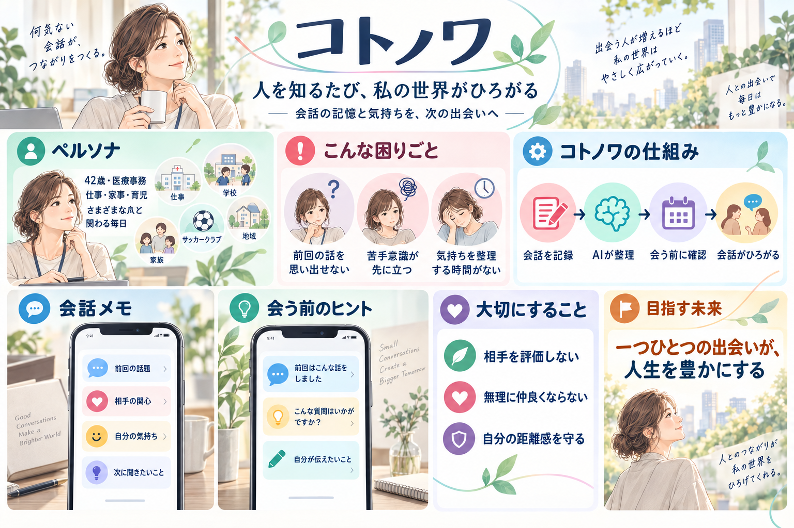

# タイトル

## コトノワ ― 人を知るたび、私の世界がひろがる

## 企画概要

人生で出会える人と、その人と一緒に過ごせる時間には限りがあります。

仕事、家庭、子どもの学校や習い事、親族、地域など、日常にはさまざまな人との出会いがあります。しかし、忙しい毎日の中では、以前どのような話をしたのかを忘れたり、苦手意識のある人との会話を避けたりして、せっかくの時間が当たり障りのない会話だけで終わってしまうことがあります。

「コトノワ」は、**相手との過去の会話と、そのときの自分の気持ちを記録し、次に会うときの会話につなげるWebアプリ**です。

会話の後に、次のような内容を自由な文章で短く記録します。

- 相手と話したこと
- 相手が関心を持っていたこと
- 会話の中で知った相手の趣味・経験・考え方
- 自分が感じたこと
- 次に聞いてみたいこと
- 次に自分から伝えたいこと

AIがメモを整理し、次に会う前に「前回の話題」「会話を始めるきっかけ」「もう少し聞いてみたいこと」「自分が大切にして話したいこと」を提示します。

すべての人と無理に親しくなったり、苦手な人を好きになったりすることが目的ではありません。自分に合った距離感や境界線を保ちながら相手を知り、人との違いや思いがけない共通点から、自分の世界を広げることを目指します。

一つひとつの出会いと会話を大切にし、その時間を自分の中に豊かな経験として積み重ねていくためのアプリです。

## ペルソナ

### 基本情報

- 仮名：田中 恵
- 年齢：42歳
- 職業：医療事務
- 家族構成：夫、中学生の娘、小学生の息子
- 夫：家事には比較的協力的だが、仕事が忙しい時期もある
- 自分の実家：車で約20分。実母から子どもの教育について口を出され、もやもやすることがある
- 夫の実家：遠方
- 性格：人との出会いや会話を楽しみたい気持ちはあるが、苦手な相手には身構えてしまう
- 価値観：さまざまな人の趣味、経験、考え方を知り、自分の知らない世界に触れたい

### 日常的に関わる人

| 生活圏 | 関わる人 |
| --- | --- |
| 仕事 | 医療事務の同僚、来院する患者 |
| 子どもの学校 | 先生、保護者、ママ友 |
| 息子のサッカー少年団 | 指導者、保護者、お当番で一緒になる人 |
| 娘の塾・進路 | 塾の先生、送迎時に会う保護者、進路について相談する人 |
| 親族 | 実母、遠方に住む夫の家族 |
| 地域 | 町内会や近所の人 |
| 家庭 | 夫、娘、息子 |

## 状況

### 場面1：以前話した相手との会話が続かない

息子のサッカー少年団のお当番で、以前一緒になった保護者と再び顔を合わせました。

前回、子どもの近況や相手の仕事について聞いた記憶はありますが、詳しい内容を思い出せません。同じことを質問してしまうのが気になり、結局、天気や試合の話など、当たり障りのない会話だけで終わってしまいます。

帰宅後になってから、「前に話していたことを、もう少し聞いてみればよかった」と思います。

### 場面2：苦手意識が先に立ってしまう

実母と話すときには、以前、子どもの教育方針について口を出されたときのもやもやが先に浮かびます。

また何か言われるのではないかと身構えてしまい、その場では自分の考えを落ち着いて伝えられません。会話が終わった後になってから、「本当はこのように伝えたかった」と後悔します。

### 場面3：忙しさで会話の準備ができない

仕事、家事、育児、送迎、学校行事、地域の用事が続き、誰かと会う前に前回の会話を思い出したり、自分の気持ちを整理したりする時間がありません。

人との出会い自体は楽しいと感じていますが、忙しさによって相手を知る余裕がなくなり、用件だけの会話になっています。

## 社会的背景と課題発生の原因

### 1. 人と接していても、つながりを実感できるとは限らない

内閣府の令和6年（2024年）調査では、孤独感を「しばしば・常に感じる」が4.3％、「時々感じる」が15.4％、「たまに感じる」が19.6％でした。これらを単純に合計すると、何らかの孤独感を持つ人は39.3％です。

女性40～49歳では、「しばしば・常に感じる」4.1％、「時々感じる」17.2％、「たまに感じる」20.8％で、単純合計は42.1％になります。また、社会活動に「参加していない」と回答した人は50.6％でした。

この調査結果から、人と接する機会があることと、安心できるつながりや所属感を持てることは、必ずしも同じではない可能性があると考えます。

出典：[内閣府「令和6年 人々のつながりに関する基礎調査」](https://www.cao.go.jp/kodoku_koritsu/torikumi/zenkokuchousa/r6.html)

### 2. 40代は、仕事上のストレスを感じる割合が高い

厚生労働省の令和5年（2023年）「労働安全衛生調査」では、仕事や職業生活について強い不安・悩み・ストレスを感じる事柄がある労働者は82.7％でした。

年齢別では40～49歳が87.9％と最も高くなっています。また、ストレスを感じる事柄がある人の29.6％が、その内容として「対人関係（セクハラ・パワハラを含む）」を挙げています。

この調査の対人関係は主に職場を対象としており、学校・地域・親族との関係まで直接示すものではありません。しかし、仕事を持つ40代のペルソナが、対人関係を含む複数の負担を抱えやすい背景を説明する資料になります。

出典：[厚生労働省「令和5年 労働安全衛生調査（実態調査）」](https://www.mhlw.go.jp/toukei/list/r05-46-50b.html)

### 3. 親しい人以外とのつながりにも価値がある

SandstromとDunnの研究では、親しい家族や友人だけでなく、知人などの「弱いつながり」との交流も、日々の幸福感や所属感と関連することが示されています。

コトノワのペルソナが日常的に出会う、職場の同僚、学校や習い事の保護者、町内会の人などは、この「弱いつながり」に近い存在です。深い友人関係にならなくても、短い会話から新しい情報や考え方を知り、地域や集団とのつながりを感じられる可能性があります。

出典：[Sandstrom & Dunn, “Social Interactions and Well-Being: The Surprising Power of Weak Ties”](https://doi.org/10.1177/0146167214529799)

### 4. 会話から得られる価値を、人は過小評価することがある

Atir、Wald、Epleyの研究では、人は知らない相手との会話から得られる情報量を、実際より少なく予想する傾向が示されています。会話は、自分では持っていなかった知識や視点を得る機会になり得ます。

この研究は海外の参加者を対象としたものであり、日本の働く子育て世代にそのまま当てはまるとは断定できません。一方で、「人との会話から自分の世界を広げる」というコトノワの提供価値を考える参考になります。

出典：[Atir, Wald & Epley, “Talking with strangers is surprisingly informative”](https://doi.org/10.1073/pnas.2206992119)

### 社会データから考える課題発生の構造

公的調査から、40代の働く人にはストレスや対人関係の負担が存在し、何らかの孤独感を持つ人も一定数いることが分かります。一方、研究からは、知人を含む多様な人との会話が、所属感、新しい情報、幸福感につながる可能性が示されています。

しかし、ペルソナは複数の生活圏を行き来し、関係ごとに異なる役割を担っています。その結果、次の構造が生まれていると考えます。

1. 関わる人が多く、過去の会話を記憶だけで管理できない
2. 仕事・家事・育児に追われ、会話前に気持ちを整える時間がない
3. 前回の内容を思い出せず、同じ質問や失礼を避けようとして用件だけの会話になる
4. 苦手な相手には、過去のもやもやが先に浮かび、身構えてしまう
5. 相手を知る機会や、自分の考えを落ち着いて伝える機会を逃す
6. 多様な人と出会っていても、新しい視点やつながりを得る経験として蓄積されない

この1～6のつながりは、現時点では企画上の仮説です。公的統計だけでは、「過去の会話を思い出せないこと」が孤独感や対人ストレスの直接的な原因だとは証明できません。対象者への聞き取りによって検証します。

### 現在の対処方法と不足していること

現在は、LINEの履歴、予定表、スマートフォンのメモ、本人の記憶などを使って、必要な情報を確認しています。しかし、次の点が不足しています。

- 相手ごとに過去の会話を振り返れる場所がない
- 情報が複数の場所に分散し、会う直前に見つけられない
- 事実だけでなく、自分が感じたことまで整理できない
- 次に聞きたいこと、伝えたいことへつながらない
- 一般的な連絡先管理や名刺管理では、生活圏をまたぐ日常的な関係と自分の気持ちを一緒に扱いにくい

## 解決したい課題

### 中心となる課題

> 限られた出会いと時間を大切にしたいと思っているのに、相手との過去の会話や自分の気持ちを整理できず、次の会話を新しい理解や気づきにつなげられない。

このペルソナは、単に話すことが苦手なのではありません。

仕事、家庭、学校、習い事、親族、地域など、複数の生活圏で多くの人と関わっているため、相手ごとの背景や過去の会話を記憶だけで管理することが難しくなっています。

また、相手についての情報だけでなく、「自分はなぜもやもやしたのか」「次は何を聞きたいのか」「どのように自分の考えを伝えたいのか」を整理する時間もありません。

本当に必要なのは、会話の話題を自動で作ることだけではなく、**会話の前に相手との記憶と自分の気持ちを整え、自分らしい状態で相手と向き合えるようにすること**です。

### 課題が発生する理由

1. **関わる人と生活圏が多い**
   職場、学校、習い事、親族、地域では、話題や相手との距離感がそれぞれ異なります。

2. **過去の会話を記憶だけに頼っている**
   以前話した内容や相手の関心を、すべて覚えておくことはできません。

3. **情報が複数の場所に分散している**
   LINE、カレンダー、スマートフォンのメモなどに情報が分かれ、必要なときに見つけられません。

4. **会話前に心の準備をする余裕がない**
   忙しさによって、「何を聞きたいか」「何を伝えたいか」を考えないまま相手と会っています。

5. **過去のもやもやが、現在の会話に影響する**
   苦手意識のある相手には、相手を知ろうとする前に身構えてしまいます。

6. **通常のメモでは、自分の気持ちまで整理できない**
   相手の情報を残すだけでは、自分が何を感じ、次はどのように関わりたいのかを整理できません。

### 課題によって起きていること

- 以前と同じ質問をするのが不安で、用件だけの会話になる
- 相手の趣味や経験、考え方を知る機会を逃す
- 共通点や新しい話題を見つけられない
- 苦手な相手との会話を避け、必要な関係まで負担になる
- 自分の考えを伝えられず、会話後に後悔やもやもやが残る
- 多くの人と出会っていても、自分の世界を広げる経験につながらない

### このアプリが扱わないこと

- 相手の性格を決めつけること
- 相手を評価、採点、攻略すること
- 相手を自分の思いどおりに動かす会話を作ること
- 苦手な相手との関係を無理に深めること
- SNSや連絡先から、本人の知らないところで情報を収集すること
- 孤独や精神的不調を診断・治療すること

## 理想の状態

> 相手との過去の会話と自分の気持ちを短時間で整理し、会う前に「何を聞きたいか」「何を伝えたいか」を確認したうえで、自分らしく会話に向き合える状態。

| 現在 | 理想の状態 |
| --- | --- |
| 前回の会話を思い出せない | 前回の話題や相手の関心を自然に思い出せる |
| 当たり障りのない会話で終わる | 相手の経験や考え方を知る会話へ広げられる |
| 苦手意識が先に立つ | 自分の気持ちと境界線を確認して、落ち着いて話せる |
| 会話後に後悔やもやもやが残る | 気持ちを整理し、次に伝えたいことへつなげられる |
| 多くの出会いが通り過ぎていく | 人との違いや共通点を、自分の新しい気づきとして積み重ねられる |

理想は、すべての人と仲良くなることではありません。無理に迎合せず、自分に合った距離感を保ちながら、必要な会話を落ち着いて行えることを大切にします。

そのうえで、相手の行動、趣味、経験、考え方を知り、会話を楽しみ、一つひとつの出会いを人生を豊かにする経験として感じられる状態を目指します。

## 想定する解決方法

1. 相手との会話後に、自由な文章で短いメモを残す
2. AIが「話題」「相手の関心」「自分の気持ち」「次に確認したいこと」に整理する
3. 利用者がAIの整理内容を確認し、必要に応じて修正する
4. 次に会う予定を登録する
5. 会う前に、前回の要点と会話のきっかけを表示する
6. 会話後に振り返り、次の関係へつなげる

AIは、相手の性格や本心を推測するためではなく、利用者本人が入力したメモを整理し、自分の気持ちと次の会話を考えるために使用します。

## 個人情報・プライバシーへの配慮

- 利用者本人が入力した必要最小限の情報だけを扱う
- 病歴、住所、学校名など、不要な機微情報を入力しないよう案内する
- AIが作成した要約は、保存前に利用者が確認・修正する
- 情報の削除機能を用意する
- 本人以外が閲覧できないことを前提に設計する
- 相手の評価ではなく、利用者自身の気持ちと次の行動を中心に記録する

## 導入・収益モデル

以下は現時点での仮説です。利用者への聞き取りと企画レビューを通して検証します。

### 導入方法

まずは、仕事・家事・育児をしながら複数のコミュニティに関わる個人向けWebアプリとして提供します。

利用開始時に「家族」「職場」「学校」「習い事」「地域」など、自分が関わる生活圏を選びます。その後、相手の名前や関係、会話メモを必要な範囲だけ自分で登録します。

SNSや連絡先から情報を自動取得せず、利用者本人が入力した必要最小限の情報だけを扱います。また、第三者の個人情報を含むため、保存する内容への注意表示、削除機能、閲覧保護などを重視します。

### 収益モデル

個人向けのフリーミアム型を想定します。

| プラン | 内容 | 料金案 |
| --- | --- | --- |
| 無料プラン | 登録人数を限定した会話メモ、基本的なAI整理、振り返り | 無料 |
| 有料プラン | 登録人数の拡張、会う前のAI要約、会話のきっかけ提案、気持ちの振り返り、リマインド | 月額480～680円程度（仮） |

決済にはStripeなどを利用し、月額課金を想定します。

ただし、「どの機能なら継続して料金を払いたいと思うか」「無料と有料をどこで分けるか」は未検証のため、対象者への聞き取りが必要です。

## 今後の仮説検証

ペルソナに近い、仕事・家事・育児を担う40代前後の人5～10人への聞き取りを行います。

### 確認する内容

1. 週にいくつの生活圏・コミュニティの人と関わっているか
2. 前回の会話を思い出せず、会話を続けにくかった経験があるか
3. 苦手な相手と会う前に、どのような準備をしているか
4. 会話や相手の情報を、現在どこに記録しているか
5. 会話メモを残すことを負担に感じるか
6. AIによる要約や質問案があれば利用したいか
7. 第三者の情報を記録することに、どのような不安を感じるか

## 企画レビューで確認したいこと

1. **ペルソナの範囲は適切か**
   「複数の生活圏で多くの人と関わる、仕事・家事・育児中の42歳女性」まで絞れているか。それとも、さらに特定の関係や場面へ絞るべきか。

2. **中心課題の置き方は適切か**
   「過去の会話を思い出せないこと」と「会話前に自分の気持ちを整理できないこと」のうち、どちらを中心課題に置くべきか。

3. **社会課題と解決方法がつながっているか**
   孤独感や対人関係の負担という社会的背景に対し、会話メモとAIによる振り返りが、日常的な関係維持を支援する手段になっているか。

4. **本当に会話の変化につながるか**
   会話メモをAIが整理することで、利用者が次の会話を始めやすくなり、相手への理解や新しい気づきにつながるか。

5. **新規性をどこに置くべきか**
   人脈管理ではなく、「相手の記憶」と「自分の気持ち」の両方を整え、会話の前後をつなぐ点を企画の新規性として示せるか。

6. **苦手な相手への支援方法は適切か**
   相手を攻略したり、無理に関係を深めたりせず、自分の境界線を保つ設計になっているか。

7. **第三者情報の扱いに問題がないか**
   相手の会話や関心を記録するにあたり、入力項目、保存期間、削除方法、注意表示など、どこまで配慮が必要か。

8. **継続して使われる仕組みになっているか**
   会話後の入力が負担にならないか。短時間で記録し、次に会う前に自然に見返せる利用の流れを作れるか。

9. **収益モデルに妥当性があるか**
   個人向け月額課金が適しているか。また、利用者がお金を払いたいと感じる価値はどの機能にあるか。

## 参考資料

- [内閣府「令和6年 人々のつながりに関する基礎調査」](https://www.cao.go.jp/kodoku_koritsu/torikumi/zenkokuchousa/r6.html)
- [厚生労働省「令和5年 労働安全衛生調査（実態調査）」](https://www.mhlw.go.jp/toukei/list/r05-46-50b.html)
- [Sandstrom & Dunn, “Social Interactions and Well-Being: The Surprising Power of Weak Ties”](https://doi.org/10.1177/0146167214529799)
- [Atir, Wald & Epley, “Talking with strangers is surprisingly informative”](https://doi.org/10.1073/pnas.2206992119)

---

※ペルソナ、課題、導入方法、料金は現時点での仮説です。今後、対象に近い人への聞き取りを行い、「特に困る相手や場面」「現在の対処方法」「記録することへの抵抗感」「料金を払ってでも欲しい支援」を確認します。
